.. _dvopmassembly-home:

######################################
DV-OPM Baseplate Assembly & Alignment
######################################

Detection Train Assembly
________________________

The detection assembly consists of a Mitakon Speedmaster 65 mm f/1.4 photographic lens serving as the primary objective (O1), followed by a 32 mm, 6-position emission filter wheel, a 90° folding mirror, a Nikon AF-S NIKKOR 85 mm f/1.4G lens serving as the secondary objective (O2), and a Ximea MU196MR-ON camera. The mechanical sequence matters because the filter wheel and the KCB2 right-angle mirror mount set the constrained spacing between O1 and O2. Once those components are installed and aligned, the remaining parts attach through fixed adapter interfaces and require comparatively little adjustment.

Assembly proceeds in the following order:

1. Review the side and top baseplate schematics to identify the mounting holes for the filter wheel, KCB2 mirror mount, LS-50 stage, and MT1B camera stage.
2. Install the 2" fold mirror in the KCB2 mount, then fasten the KCB2 to the detection baseplate.
3. Load the emission filters into the FW-0002-6 filter wheel, attach the C60-FW adapter, and fasten the filter wheel to the baseplate.
4. Build a downward-propagating collimated reference beam from an elevated platform.
5. Use the reference beam to align the KCB2 mirror so that the incoming vertical beam is reflected along the O2 axis with correct tip, tilt, and 45° fold geometry.
6. Install the O1-side adapter stack between the C60-FW adapter and the Mitakon lens.
7. Install the O2-side SM2 adapter stack, camera stages, modified camera, and Nikon lens.
8. Use the reference beam through the filter wheel, KCB2, and O2 to set the MT1B camera focus position.
9. Mount the completed detection train to the LS-50 vertical stage for integration under the sample stage.

Detection Baseplate Hole Map
^^^^^^^^^^^^^^^^^^^^^^^^^^^^

The side face of the L-shaped detection baseplate carries the filter wheel, the KCB2 fold mirror mount, and the LS-50 vertical stage interface. The horizontal face carries the MT1B linear stage used for camera focus adjustment.

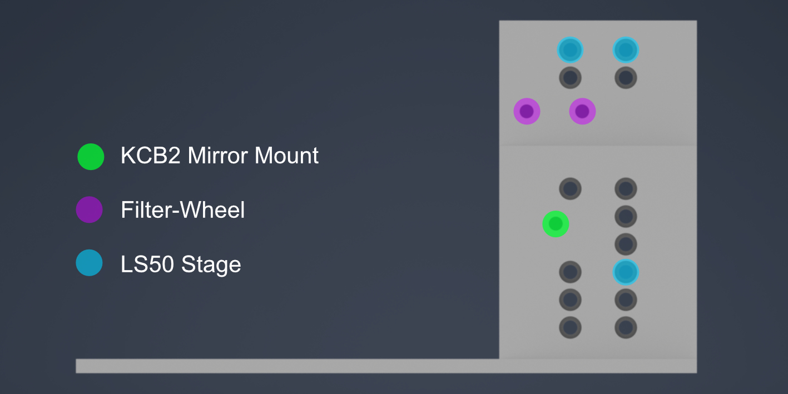

   **Figure 1:** Side schematic of the detection baseplate. The colored holes indicate the KCB2 mirror mount, filter wheel, and LS-50 stage mounting locations.

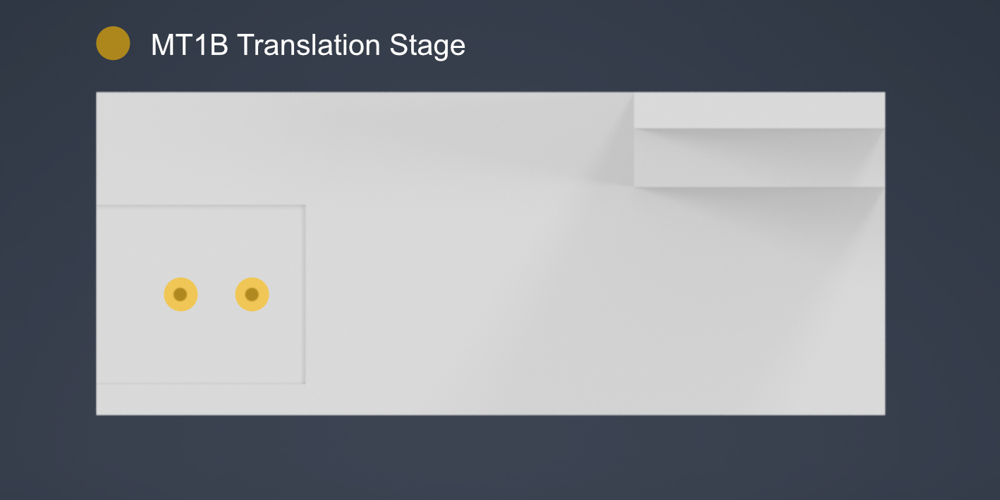

   **Figure 2:** Top schematic of the detection baseplate. The highlighted holes are used to mount the MT1B translation stage for camera focus adjustment.

KCB2 Mirror Installation
^^^^^^^^^^^^^^^^^^^^^^^^

Install the 2" fold mirror in the KCB2 right-angle kinematic mirror mount before attaching the mount to the baseplate. The manuscript parts list specifies a `PF20-03-P01 protected silver mirror <https://www.thorlabs.com/thorproduct.cfm?partnumber=PF20-03-P01>`_ in a `KCB2 right-angle kinematic mirror mount <https://www.thorlabs.com/newgrouppage9.cfm?objectgroup_id=2792&pn=KCB2>`_. Thorlabs specifies that the KCB2 is rear-loaded and secures a 2" optic with a nylon-tipped setscrew. Tighten the setscrew only enough to hold the optic securely; excessive force can distort or damage the mirror.

With the mirror installed, place the KCB2 at the indicated side-face location on the detection baseplate and fasten it from the side using a 1/4"-20 screw. While tightening the screw, place a circular bubble level on the top center of the KCB2 body. Keep the mount level as the screw is brought down to final torque. This step does not complete optical alignment, but it prevents the mount from being clamped into the baseplate with a large mechanical roll error.

Filter Wheel Installation
^^^^^^^^^^^^^^^^^^^^^^^^^

Load the required emission filters into the FW-0002-6 filter wheel before mounting it to the baseplate. Follow the filter-loading procedure in the `ASI FW-1000 filter wheel manual <https://asiimaging.com/docs/fw_1000>`_, which covers the relevant ASI filter-wheel loading procedure; the manual describes current side-loading filter wheels, use of the ring-load tool, filter orientation, and balanced loading of filter positions. In this implementation, the filter wheel was equipped with Semrock filters for the green (515/30-32), red (595/31-32), and far-red (670/30-32) channels.

After the filters are installed, screw the C60-FW adapter onto the top side of the filter wheel. Position the filter wheel on the detection baseplate at the indicated side-face mounting holes. As with the KCB2, use a circular bubble level at several positions on the filter wheel housing while tightening the mounting screws. The goal is for the filter wheel to sit flat against the baseplate, because it defines the mechanical entrance reference for O1 and the downstream fold mirror.

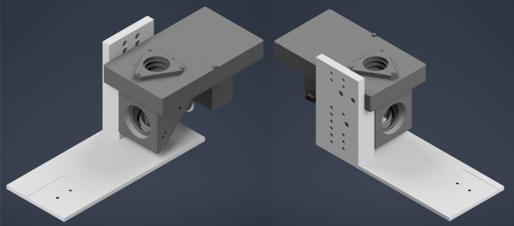

   **Figure 3:** Filter wheel and KCB2 mirror mount installed at their predetermined side-face locations on the detection baseplate. Showed in the above picture in two different views.

Reference Beam Setup
^^^^^^^^^^^^^^^^^^^^

The KCB2 mirror alignment is easiest if the detection baseplate is aligned to a straight, collimated reference beam that propagates downward from above. The logic is the same as standard two-iris beam walking, but adapted to a vertical reference leg. Thorlabs provides a useful `beam-alignment video and written guide <https://www.thorlabs.com/newgrouppage9.cfm?objectgroup_id=12211&tabname=Best+Practices>`_ for the two-iris method; the steps below describe the geometry used for this detection baseplate.

1. Place a laser source and collimator on an elevated platform above the detection baseplate. In our setup, a reflective collimator was used to produce a broad collimated reference beam.
2. Use a 1" right-angle kinematic mirror mount to fold the elevated horizontal beam downward toward the detection baseplate.
3. Mount the collimator and the fold mirror on translation stages so the beam position can be tuned without disturbing the baseplate.
4. Place two irises in the reference-beam path. Keep the iris orientation fixed during alignment so that any small decentering of the iris aperture does not move the reference.
5. Place a flat mirror at the downward beam incidence point on the optical table or baseplate plane.
6. Adjust the elevated fold mirror until the back-reflected beam retraces the incoming path through both irises. When the back-reflection remains centered through both irises, the downward beam is normal to the flat mirror and can be used as a vertical reference beam.

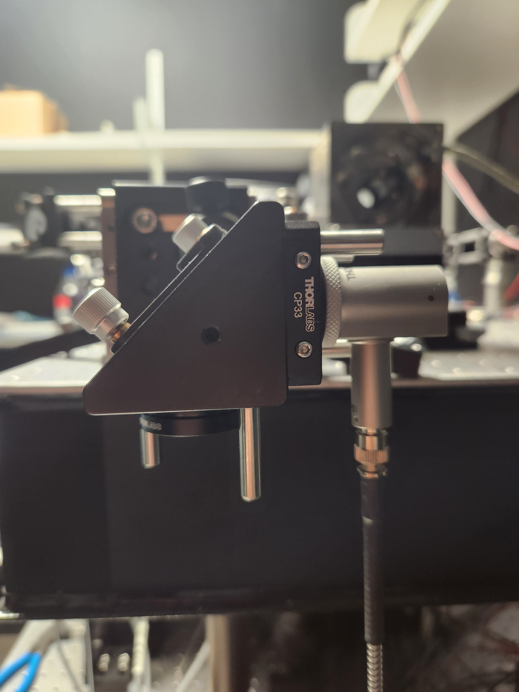

   **Figure 4:** Elevated reference-beam setup used to direct a collimated beam downward toward the detection baseplate.

.. figure:: Images/iris_tube.png
   :align: center
   :width: 65%
   :alt: Reference-beam alignment path with irises mounted for beam-centering checks.

   **Figure 5:** Irises used to define and verify the reference-beam path.

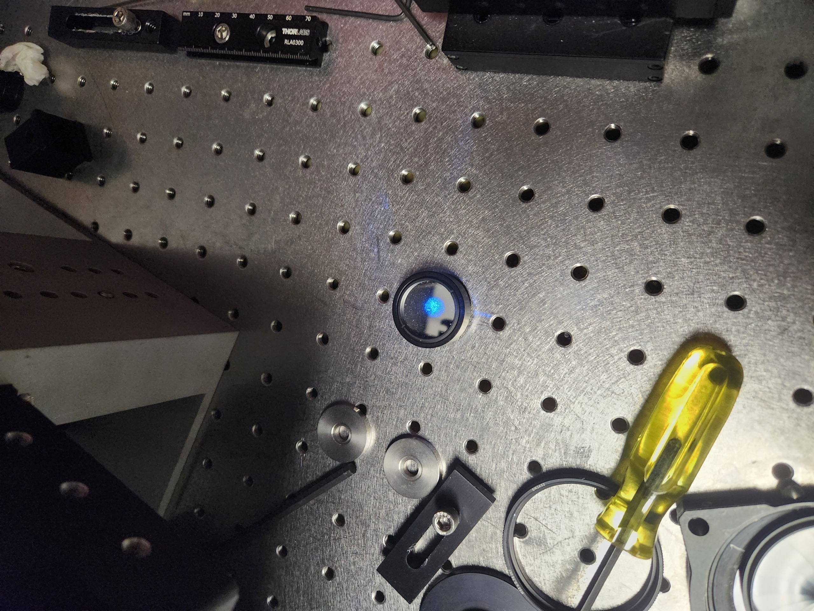

   **Figure 6:** Flat mirror used to check that the downward reference beam retroreflects through the alignment irises.

KCB2 Mirror Alignment
^^^^^^^^^^^^^^^^^^^^^

After the reference beam is established, use it to align the KCB2 mirror. The goal is not to measure the mirror angle with a protractor; the correct 45° fold is defined optically. A vertical reference beam entering through the filter-wheel side should reflect from the KCB2 and propagate along the horizontal O2 axis.

1. Position the detection baseplate so that the downward reference beam passes through the filter wheel entrance aperture and reaches the KCB2 mirror.
2. Place a ground-glass diffuser, pinhole, or alignment target at the filter-wheel entrance to confirm that the reference beam is centered.
3. Thread the SM2 alignment tube or temporary mirror-tube assembly into the KCB2 exit port. Use it as a visual target for the horizontal exit beam and, when needed, as a back-reflection check.
4. Adjust the KCB2 tip and tilt controls until the reflected beam is centered through the exit port and retraces the intended path.
5. Tighten the KCB2 adjuster locks gently and re-check beam centering. Locking can slightly shift the mount, so this should be done iteratively.

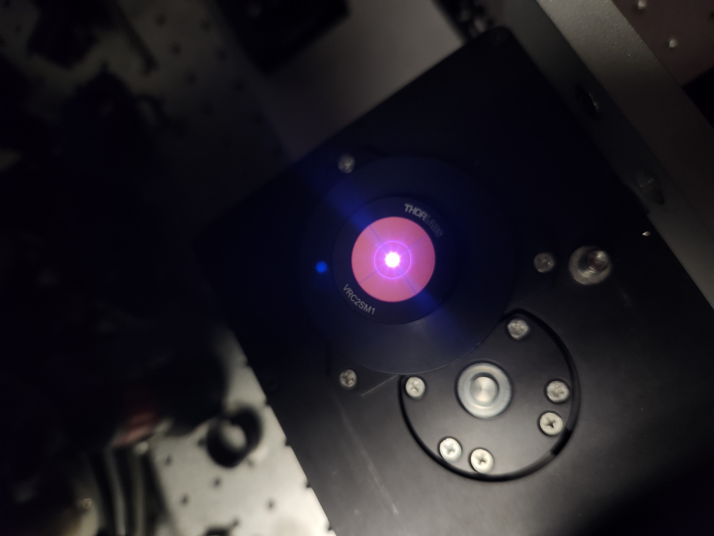

   **Figure 7:** Centering the reference beam through the filter-wheel entrance aperture before aligning the KCB2 mirror.

.. figure:: Images/mirror_tubes.png
   :align: center
   :width: 75%
   :alt: Temporary mirror-tube assembly used for KCB2 back-reflection alignment.

   **Figure 8:** Temporary mirror-tube assembly used to verify the KCB2 output axis by back-reflection.

.. figure:: Images/aligned_filter.png
   :align: center
   :width: 75%
   :alt: Aligned KCB2 mirror showing coaxial return of the reference beam.

   **Figure 9:** Aligned KCB2 mirror after tip/tilt adjustment. The back-reflection is coaxial with the incident reference beam.

O1 Adapter Stack
^^^^^^^^^^^^^^^^

Once the filter wheel and KCB2 are aligned, assemble the O1-side adapter stack. Insert the custom machined 38 mm to SM2 adapter into the C60-FW adapter and tighten the C60-FW locking screws to hold the custom adapter. Thread the SM2A53 adapter onto the custom adapter. On the Mitakon O1 lens, install the 72 mm to 52 mm step-down ring, then couple the lens to the SM2A53-side adapter stack.

The Mitakon O1 aperture ring sets the effective detection NA. Although the lens can be opened further, the implemented microscope is operated at NA = 0.18 to reduce aberrations across the field and because the filter-wheel aperture becomes a practical limiting aperture in the current geometry. The O1 focus setting is not a sensitive alignment parameter for this relay, so the aperture setting is more important than the exact focus-ring position during assembly.

Camera And O2 Preparation
^^^^^^^^^^^^^^^^^^^^^^^^^

Prepare the camera before installing O2. The Ximea MU196MR-ON sensor cover glass was professionally removed by Pacific Crest Imaging. This step should be performed by a sensor-modification service rather than attempted during microscope assembly. After the cover glass is removed, replace the factory sensor cap with the custom machined cap. The custom cap preserves the usable field when the camera is later rotated relative to the optical axis.

Mount the MT1B linear stage to the two highlighted holes on the horizontal detection baseplate. Mount the RP005 rotation stage on top of the MT1B. Then mount the custom machined camera holder on the RP005 rotation stage and fasten the Ximea camera into the holder. Keep the camera unrotated for the O2 focus-position step below; the final sensor angle is adjusted later during system alignment.

Before mounting O2, set the Nikon lens focus to infinity and fully open its aperture. Infinity focus fixes the internal focusing group position, and opening the aperture prevents the Nikon lens from clipping the relay or unintentionally setting the detection NA. The Nikon AF-S NIKKOR 85 mm f/1.4G does not have an external aperture ring, so the rear aperture lever must be held open manually. A thin, rigid shim can be used to hold the lever open, taking care not to touch the rear optical surface.

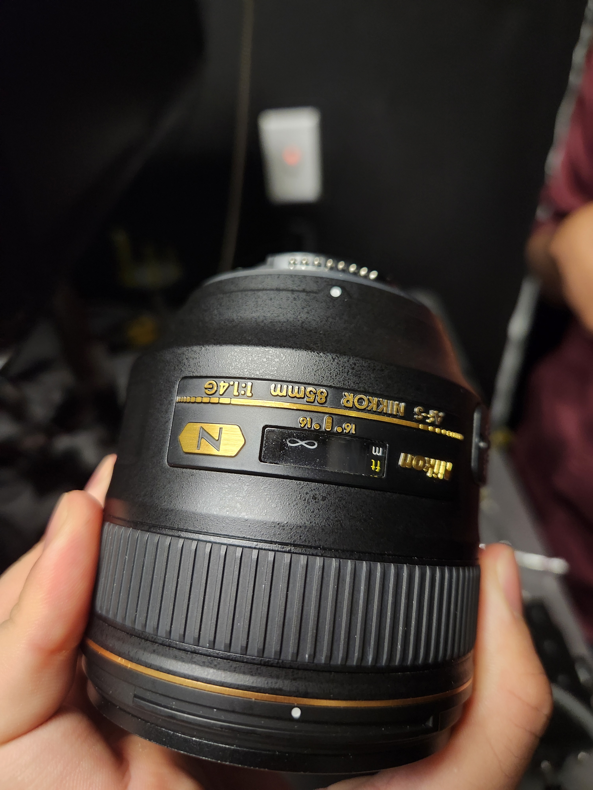

   **Figure 10:** Set the Nikon O2 focus ring to infinity before mounting the lens.

.. figure:: Images/o2_aperture.png
   :align: center
   :width: 75%
   :alt: Nikon O2 aperture held open with a shim at the rear aperture lever.

   **Figure 11:** Open the Nikon O2 aperture by holding the rear aperture lever in the fully open position.

O2 Installation And Camera Focus
^^^^^^^^^^^^^^^^^^^^^^^^^^^^^^^^

Install the O2-side adapter stack on the Nikon lens: first add the 77 mm to 52 mm step-down ring, then the 52 mm to 52 mm coupler, and then the SM2A52 adapter. Thread the prepared Nikon lens assembly into the SM2-threaded exit port of the KCB2 mount.

Use the same reference beam to set the camera focus position. Send the beam through the filter-wheel opening, KCB2 mirror, and O2 toward the camera. This check can be done with O1 removed if the Mitakon lens blocks convenient access to the filter-wheel entrance; do not disturb the C60-FW adapter or KCB2 alignment. Add neutral-density filters at the beginning of the reference beam path to avoid saturating the sensor. View the live beam image in Ximea CamTool or ``navigate`` if the acquisition configuration has already been set up. With the camera still facing straight, translate the MT1B linear stage until the spot on the camera is as small and tightly focused as possible. Lock the MT1B stage after the focus position is found.

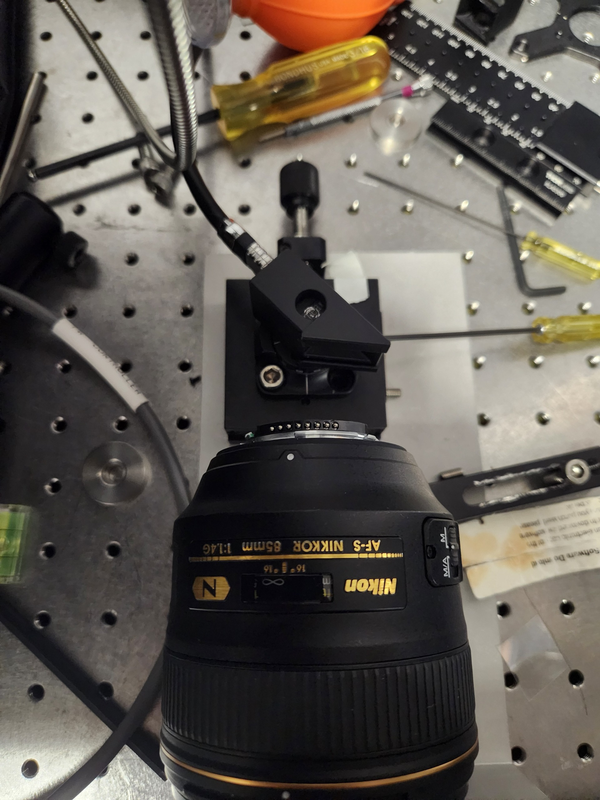

   **Figure 12:** O2 and camera setup used to locate the MT1B focus position with the reference beam.

LS-50 Stage Mounting
^^^^^^^^^^^^^^^^^^^^

The detection train is now assembled and internally aligned. The final mechanical step is to mount the detection baseplate to the LS-50 vertical stage so that the complete detection module can be positioned under the sample stage. Use the two upper LS-50 mounting screws on the side of the detection baseplate and the third screw at the lower-right LS-50 mounting position. After fastening the stage, verify that the detection baseplate moves vertically without mechanical interference and that the filter wheel, KCB2 mount, O2 lens, and camera holder remain rigidly fixed relative to one another.

---------------

Illumination Train Assembly
___________________________

Breakdown of Baseplate Holes
^^^^^^^^^^^^^^^^^^^^^^^^^^^^

The baseplate includes a series of holes for mounting the various optical components of the illumination train. Most of the optical components are mounted on Thorlabs Polaris Post with Polaris mounts, with a few exceptions. And there are some holes which purely for alignment purposes and would not be used once done with the alignment process. The following figure is a breakdown of the holes on the baseplate and their intended use:

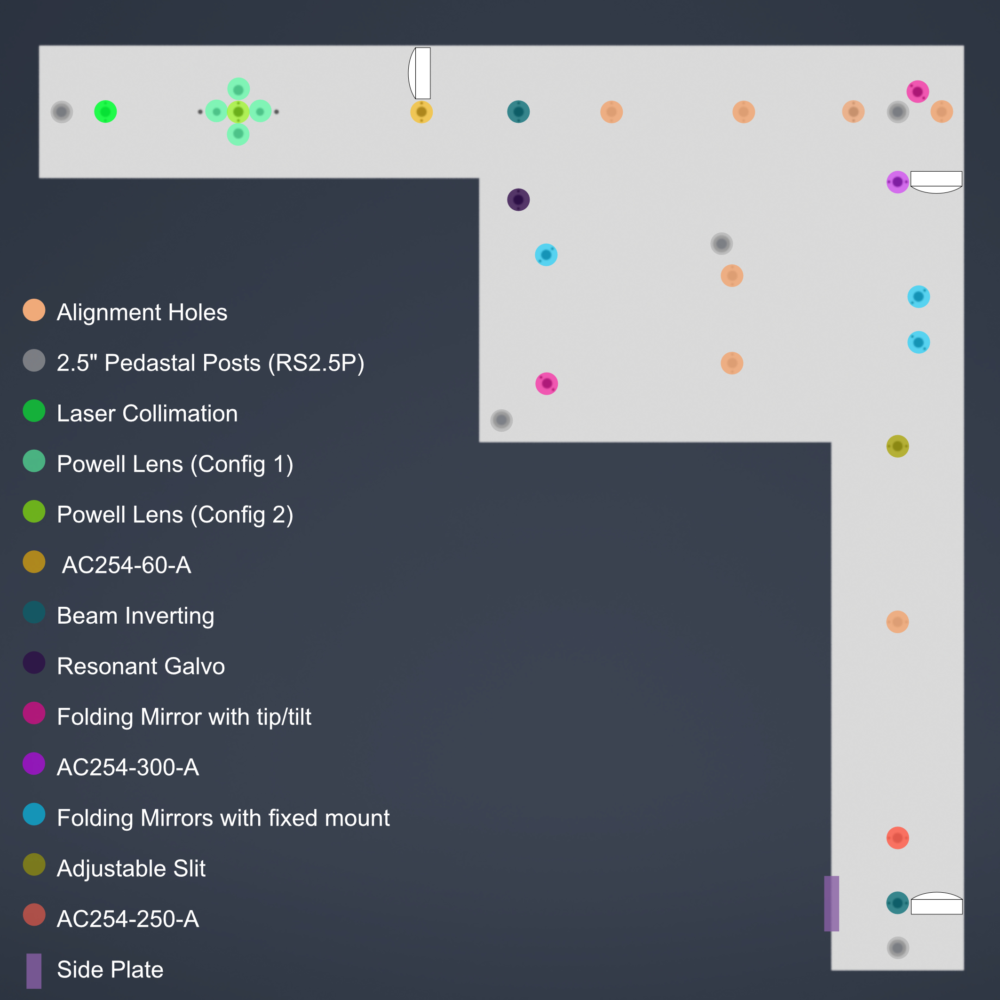

   **Figure 13:** Labelled schematic of the baseplate showing the intended use of each hole for mounting optical components or for alignment purposes.

Overview of the Illumination Train Assembly Process
^^^^^^^^^^^^^^^^^^^^^^^^^^^^^^^^^^^^^^^^^^^^^^^^^^^

The assembly of the illumination train is a multi-step process that involves the careful installation and alignment of various optical components. The following steps outline the general procedure for assembling the illumination train:

1. Mount the baseplate on the pedastal posts

2. Laster Collimation and Alignment

3. Mounting the Galvo Scanner and the first K1S4 mount with mirror 

4. Mounting the foldings Mirrors and ensuring alignment

5. Mounting the Optical Lenses

6. Mount the second K1S4 mount with mirror to fold the beam up

7. Gluing the D-Shaped Mirror on the Side Plate

8. Fastening the Side Plate on the main Baseplate.

9. Mounting the Powell Lens

10. Mounting Mechanical Slit

10.Cross-check the positon of the Powell and use the translation stage to fine-tune the position of the Powell lens.

---------------

Mounting Baseplate on Optical Table
^^^^^^^^^^^^^^^^^^^^^^^^^^^^^^^^^^^

To mount the baseplate onto an optical table, the process requires screwing 1/4"-20 screws onto 2.5" pedastal posts (`RS2.5P <https://www.thorlabs.com/item/RS2.5P>`_). There are multiple holes on the baseplate for pedastal posts, we recommend at least using the 5 pedastal posts for all 5 vertices. You could either use clamps to fasten the pedastal posts on the optical table or use cap screws in which case first fasten the pedastal posts on the optical table and then mount the baseplate on top of the pedastal posts. 
The whole system has been made keeping in mind of the height of the pedastal posts, so using 2.5" pedastal posts will ensure that the baseplate is at the proper height to correctly couple with the detection module.

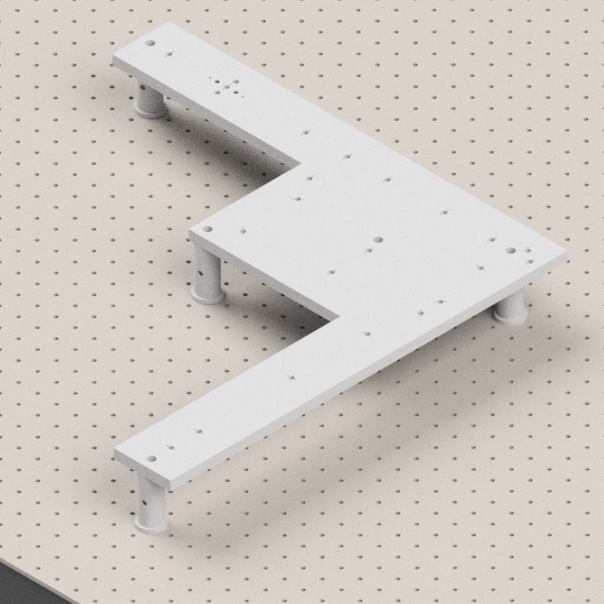

    **Figure 14:** Mounting the baseplate on the optical table using pedastal posts.

---------------

Initial Laser Collimation
^^^^^^^^^^^^^^^^^^^^^^^^^

When first assembling the system, ensuring proper output collimation from the fiber laser source is critical. There are multiple checks that one can take for this step, but we utilize a combination of a `shear-plate interferometer <https://www.thorlabs.com/newgrouppage9.cfm?objectgroup_id=2970>`_ and two pinhole apertures placed at opposite ends along the length of the baseplate. Shear-plate interferometers are designed to split and interfere an input beam of coherent light, such that when the beam is collimated there are interference fringes aligned vertically with a reference line. The fiber laser collimator we used for this system is the `Thorlabs CFC11A-A <https://www.thorlabs.com/thorproduct.cfm?partnumber=CFC11A-A>`_, which features an adjustable barrel which controls the position of collimation optics within the element.

The basic assembly process involves first inserting and fixing the CFC11A-A into a Thorlabs AD15S2 adapter, which allows it to then be mounted into a 2.5" Polaris K1XY mount (We used a combination of a custom machined 0.5" spacer with 2" Polaris Post). This assembly is then mounted onto the respective Polaris post at the start of the baseplate. The fiber laser source is then able to be directly mounted into the CFC11A-A, making sure that the protrusion on the fiber wire aligns with the open section of the CFC11A-A port. The basic process of ensuring collimation then involves turning on the laser source, and placing the shear-plate interferometer such that the input port aligns with the output of the laser unit. Then, by slowly adjusting the barrel of the CFC11A-A and observing the interference fringe orientations along the top display of the interferometer, one is able to adjust the beam until it is properly collimated.

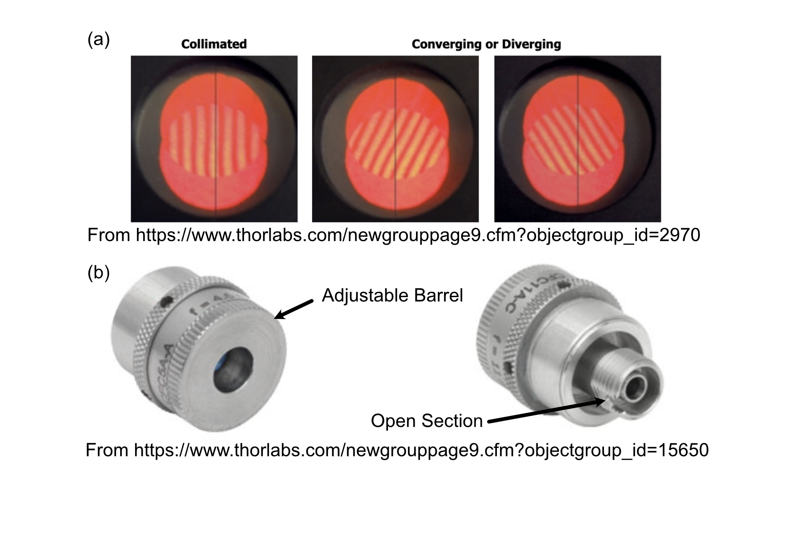

    **Figure 15:** Shear Plate interferometer and collimator lens

----------------

Initial Alignment
^^^^^^^^^^^^^^^^^

With the beam collimated, the process of beam alignment involves adjusting the position control knobs on the K1XY to have the beam pass through two pinhole apertures along the optical path. The height of the initial laser output is designed to be at 3.75" above the top surface of the baseplate, so selecting appropriate post heights for the apertures such that their centers rest at 3.75" is essential. 
In our case we use a 2.5" post with 1XY mount to hold the `P2000K1 pinhole apertures <https://www.thorlabs.com/thorproduct.cfm?partnumber=P2000K1>`_ or any adjustable iris which has SM1 threading, however  if using Polaris 1XY mount, **the user must not adjust the XY adjusment screws on the 1XY mount and treat it as fixed in the whole alignmennt process**.
The other way is using `Thorlabs ID12 <https://www.thorlabs.com/thorproduct.cfm?partnumber=ID12>`_ pinhole apertures, so using a post height of 3.25" will ensure that they are at the proper height for alignment. We designed a `custom ID12 to Polaris adapter <https://github.com/TheDeanLab/altair/tree/main/downloads/common/cad>`_ to ensure the aperture is at the proper height and properly aligned along the designated Polaris axis. 
Either way, the key is to ensure that the pinholes are at the correct height and you could have one of these pinholes placed at the powell lens hole and one at the other end of the baseplate as shown in the figure below. There are multiple alignments holes in between and one can use them too, it is always better to check far away. 
With the pinholes placed, the process becomes iterative by making small adjustments on the K1XY tip/tilt knobs and XY position screws until the beam passes through both pinholes.

.. figure:: Images/K1XY_Step_1.png
    :align: center
    :alt: Initial beam alignment using pinholes

    **Figure 16:** Alignment setup with a pair of pinholes with 1XY mount for initial beam alignment.

.. figure:: Images/LaserAlignment2.png
    :align: center
    :alt: Performing beam alignment across the baseplate

    **Figure 17:** Performing beam alignment using ID12 and custom adapter for it.

---------------

Placing the Galvo and the K1S4 Mirror Mount
^^^^^^^^^^^^^^^^^^^^^^^^^^^^^^^^^^^^^^^^^^^

Now that the beam is collimated and aligned, the next step is to mount the galvo scanner and the first K1S4 mount with mirror, which will decrease the optical axis height by a inch. 
For the Resonant Galvanometer, use a 3" Polaris Post, and mount the custom galvo adapter on top of the post using dowell pins and 3/8" screw, then carefully insert the galvo scanner through the adapter bore and fasten a little using 3/8" screws but do not tighten yet. Make sure the reflecting surface faces the correct direction.
For the K1S4 mount, use a custom K1S4 post and mount the K1S4 on top of the post using dowell pins, then insert a mirror into the mount and fasten it using the provided screw. 
Now we also put in the first folding mirror which is at the corner of the baseplate, and this mirror is mounted in a B1F mount which gets mounted on the 2" Polaris Post. Detailed instructions for mounting the optics in B1F can be accessed in ThorLabs Specs Sheet.
We need to have atleast 2 pinholes for this step, one nearest to the K1S4 mount and one at the end of the baseplate. We need to use 1.5" post with 1XY mount to hold the pinhole.
The figure below shows the galvo scanner, the first K1S4 mount with mirror, the first folding mirror mounted on the baseplate and a pinhole at the end of the baseplate.
Now the goal is to make sure that the beam reflects off the mirror and passes through the pinhole at the end of the baseplate and at this point. For the vertical alignment, you can adjust the tip knob on the K1S4 mount and the rotation of the galvo scanner. Adjust the galvo scanner to make sure the beam the passthrough the first pinhole and adjust the tip knob of the K1S4 mount to make sure the beam passes through the second pinhole at the end of the baseplate. Iteratively adjusting both will make the beam at the correct height throughout, if beam is laterally shifted on the pinholes, use the tilt knob on the K1S4 mount to make the adjustment.
Once the beam is passing through the pinhole at the end of the baseplate, you can then tighten the screws on the galvo scanner.

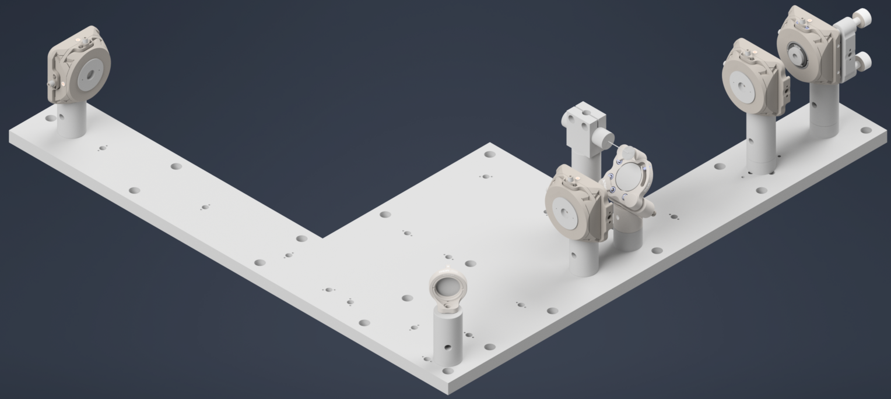

    **Figure 18:** Aligning the beam across the baseplate through the galvo scanner and the first K1S4 mount and the first folding mirror

---------------

Folding Mirrors
^^^^^^^^^^^^^^^

Now, the next step is to mount the remaining folding mirrors and ensure that the beam still passes through the pinholes. We begin by only the corner mirror first.
Ideally, you wouldn't need to make any adjustment to make the beam pass through the pinholes, if the beam aligned correctly in the previous step and that the folding mirrors are correctly mounted. 
If there is still slight misalignment, you can first try to rotate the folding mirrors' post (they have a little room play with) if not you can adjust the tip/tilt knobs on the K1S4 mount until the reflected beam passes through both pinholes.
Also, you could use the aligment holes in between the folding mirrors at different positions to inspect at which point is the beam getting misaligned if any, and make the adjustment accordingly.

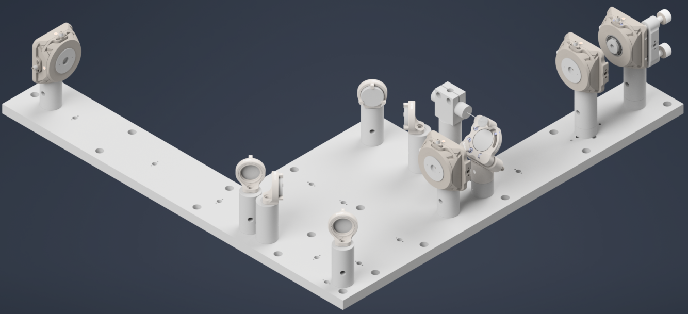

    **Figure 19:** Mounting all the folding mirrors in the path and ensuring the beam is properly aligned through the pinholes.

---------------

Mounting the Optical Lenses
^^^^^^^^^^^^^^^^^^^^^^^^^^^

Now that the beam is properly aligned with the folding mirrors, the next step is to mount the optical lenses. 
We only mount the achromatic doublet lenses first, and the powell lens is mounted at the end.

The f=60mm AC254-60-A achromatic doublet lens is mounted on a 3" polaris post in a B1S mount, and the f=300mm AC254-300-A achromatic doublet lens is mounted on a 2" polaris post in a B1S mount and the f=250mm AC254-250-A achromatic doublet lens is mounted on a 2" polaris post in a B1S mount as well.
The process of mounting the lenses is straightforward, but the key is to ensure that the lenses are mounted at the correct positions, facing the correct direction, and that the beam passes through the center of the lenses. The figure below shows the achromatic doublet lenses mounted on the baseplate.
You could chose to check the back reflection of the lenses to make sure they are properly mounted and that the beam is passing through the center of the lenses, but it is not necessary.

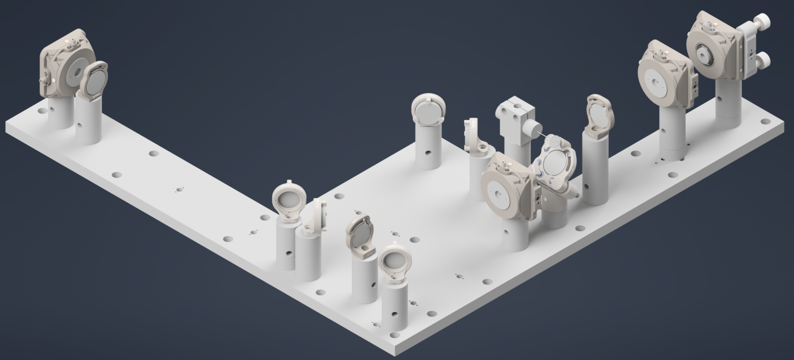

    **Figure 20:** Mounting the achromatic doublet lenses on the baseplate

---------------

Fold the Beam Up
^^^^^^^^^^^^^^^^

Now, switch the 1XY mount with pinhole at the end of the baseplate with the second K1S4 mount with a mirror which will fold the beam up.

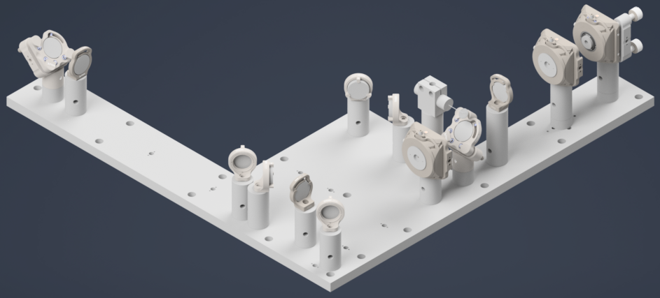

    **Figure 21:** Mounting the second K1S4 mount with mirror

Now, the final alignment check is to make sure the beam is correctly folding  up and passing through the center.
For this step, we used a `DG10-1500-H1-MD <https://www.thorlabs.com/thorproduct.cfm?partnumber=DG10-1500-H1-MD>`_ put on a custom adapter. The custom adapter can be mounted to the side of the baseplate and you can just place the Alignment disk on top of the adapter.

.. figure:: Images/K1XY_RG_K1S4_Ms_Ls_K1S4_Align_Step_7f.png
    :align: center
    :alt: Alignment disk mounted on the side of the baseplate for final alignment check.

    **Figure 22:** Alignment disk mounted on the side of the baseplate for final alignment check.

---------------

Gluing the D-Shaped Mirror on the Side Plate
^^^^^^^^^^^^^^^^^^^^^^^^^^^^^^^^^^^^^^^^^^^^

Now, we need to glue the D-Shaped mirror on the side plate and then fasten the side plate on the main baseplate. The D-shaped mirror is used to reflect the beam from the illumination train into the detection module, so it is crucial to ensure that it is properly aligned and securely attached.
The D-shaped mirror is glued onto the side plate using a high-quality optical adhesive. We used `Norland Optical Adhesive 81 <https://www.thorlabs.com/thorproduct.cfm?partnumber=NOA81>`_, which is a UV-curable adhesive that provides strong bonding and excellent optical clarity. 
The process involves applying a small amount of the adhesive to the socket in the side plate where the D-shaped mirror will be placed. You don't a thick layer of adhesive, just a thin layer evenly applied to the base and curved surface. Then place the D-Shaped mirror followed by curing from all the directions, and then curing it under UV light according to the manufacturer's instructions.

.. figure:: Images/NOA81.jpeg
    :align: center
    :alt: D-Shaped mirror glued onto the side plate.
    :width: 90%

    **Figure 23:** The choice of glue used for attaching the D-Shaped mirror.

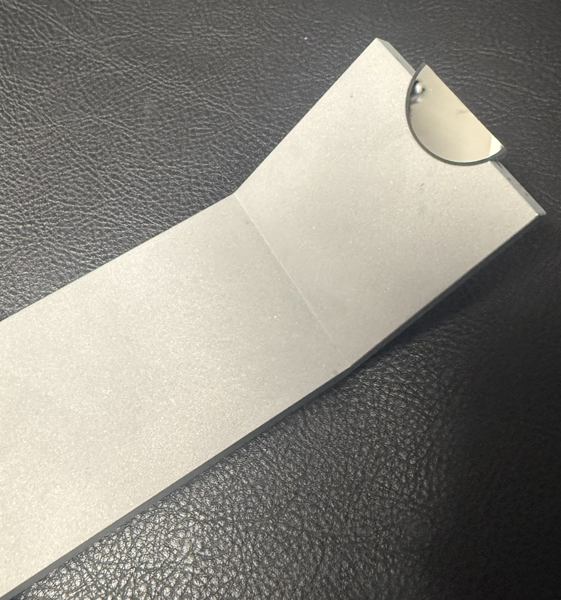

    **Figure 24:** D-Shaped mirror glued onto the side plate.

---------------

Mounting the Side Plate 
^^^^^^^^^^^^^^^^^^^^^^^

Once the D-shaped mirror is securely attached to the side plate, the next step is to fasten the side plate onto the main baseplate. The side plate is designed to be mounted onto the main baseplate using dowell pins and 1/4-20 screws, so you will need to put the dowell pins in the baseplate side holes and then align the holes on the side plate on the main baseplate and then secure it in place using screws.

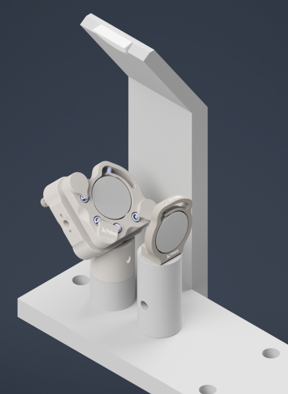

    **Figure 25:** Side plate fastened onto the main baseplate.

-------------------------

Powell Lens Assembly
^^^^^^^^^^^^^^^^^^^^

Our illumination path utilize a Powell lens as the element that forms the light sheet profile. Our mounting scheme for the Powell lens offers control over all 3 axes (x, y,
and z), where the Polaris 1XY Mount covers x and y and the LNR25M covers z. We found that outside of the Polaris 1XY
for centering the Powell lens precisely on the beam, due to tolerances of the Powell lens from Laserline, we
also needed to adjust the distance between the Powell lens and L2 to have our physical system align with our
simulations.

**Step 1: Fixing the Powell lens into the AD9F Mount**

For the first step, get a piece of optical tissue paper and the AD9F and Powell lens. Place the flat face of the
Powell lens onto the tissue paper, and then place the AD9F onto the Powell lens such that the front surface of the
smaller side of the AD9F is flush with the flat face of the Powell lens. Use the two mounting screws on the AD9F to
secure the lens in place.

.. card:: Powell Lens into AD9F Assembly

   .. raw:: html

      <video controls style="width:50%;">
        <source src="Images/Videos/Assembly/PowellAD9F.mp4" type="video/mp4">
        your browser doesn't support video
      </video>

**Step 2: Install the LRM1 rotation Mount into the Polaris 1XY**

Screw the threaded portion of the LRM1 into the threaded hole on the Polaris 1XY until the back surface of the LRM1
is flush with the front of the 1XY.

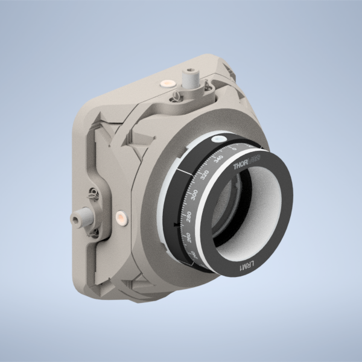

    **Figure 26:** Screwing the LRM1 into the 1XY

**Step 3: Install the LNR25M onto the Baseplate**

There are a variety of holes on the baseplate that one can use to fix the LNR25M in place. In the graphic below, the
two holes in red on the top of the LNR25M allow you to thread 1/4-20 screws directly through the LNR25M into the
threaded holes on the baseplate below. There are also two 3 mm-diameter dowel pins on the bottom of the LNR25M that
have corresponding holes on the baseplate in blue. Finally, there are three holes on the baseplate in yellow that
correspond to threaded holes on the bottom of the LNR25M, 1/4-20 screws can be used to secure the LNR25M through
these holes the same way that one would fix the other Polaris posts on the baseplate in place.

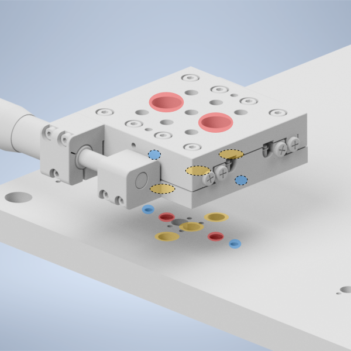

    **Figure 27:** placing the LNR25M onto the baseplate

**Step 4: Fix the 1" Polaris Post onto the LNR25M to Polaris adapter**

Then take the LNR25M to Polaris adapter and using the same 2 mm dowel pins and 1/4-20 screws that the other Polaris
posts in the system use, fix the 1" Polaris post onto the adapter by screwing in a 1/4-20 screw from the bottom of
the adapter into the post.

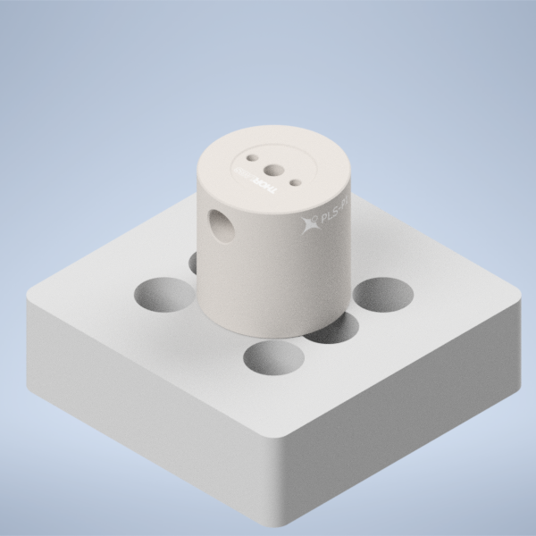

    **Figure 28:** placing the 1" Polaris Post onto the LNR25M Adapter

**Step 5: Install the LNR25M to Polaris adapter onto the LNR25M**

Then using the four holes on the top of the adapter surrounding the 1" post, place 1/4-20 screws in those holes and
screw them into the top of the LNR25M

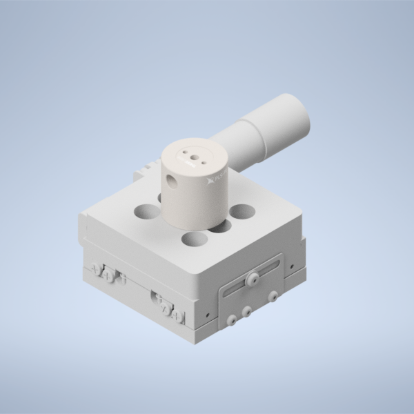

    **Figure 29:** placing the LNR25M Adapter onto the LNR25

**Step 6: Fix the Polaris 1XY onto the 1" Polaris post**

Using an 8-32 screw and the 2 mm dowel pins, fix the Polaris 1XY onto the top of the 1" Polaris post assembly.

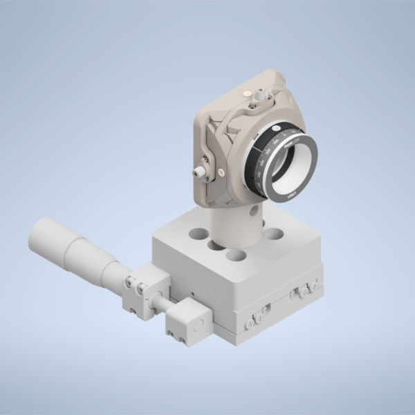

    **Figure 30:** Fixing the Polaris 1XY onto the 1" Polaris Post

**Step 7: Screw in the AD9F into the LRM1 mount until it's fully threaded**

Finally, screw in the AD9F fully into the LRM1 mount threading.

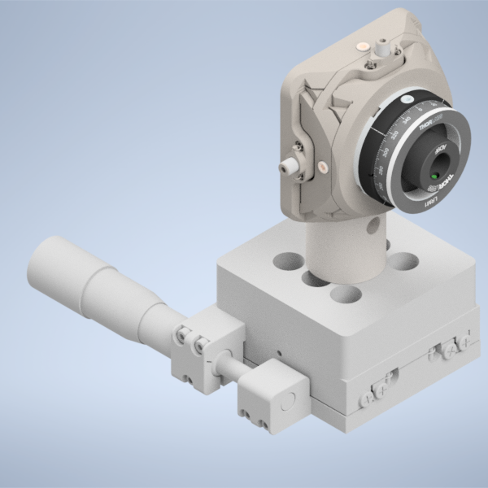

    **Figure 31:** Threading the AD9F into the LRM1 mount

There will also an alternate way to mount the 1XY on the baseplate, which is to use XP10X with an actuator XP10X-C1.
You will first mount a 1.5" Polaris Mount with a custom height adapter on the baseplate.
Then you will mount the XP10X on top of the Polaris Mount using dowel pins and 1/4-20 screw, and then mount the Polaris 1XY onto the XP10X-C1 using dowel pins and 8-32 screw.

.. figure:: Images/XP10X_1XY_Powell_Lens_Steps.jpg
    :align: center
    :alt: Mounting the Polaris 1XY onto the XP10X-C1

    **Figure 32:** Mounting the Polaris 1XY onto the XP10X-C1

------------------

Mechanical Slit Assembly
^^^^^^^^^^^^^^^^^^^^^^^^

We use a mechanical slit to control the aperture of the light sheet.
We first mount the VA100CP mechanical slit on the custom adapter usign 3/8" screw, and then mount the custom adapter onto the Polaris Mount using dowel pins and 3/8" screw. Finally, we mount the Polaris Mount onto the baseplate using dowel pins and 1/4-20 screws.
The slit should be placed at the focal plane of the second achromatic doublet, so that it can effectively control the aperture of the light sheet. If you can't find the focus at the mechanical slit, you can play with the position of the powell lens a little using the translation stage it sits on, and you should be able to find the focus at the mechanical slit.

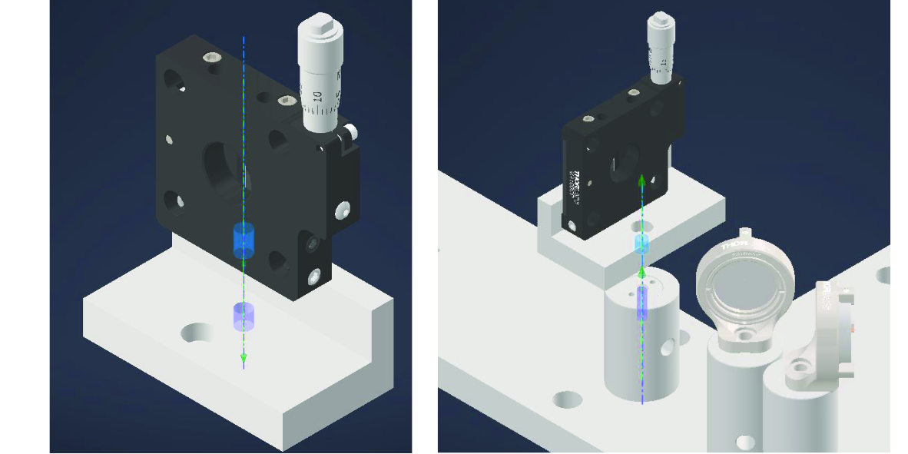

    **Figure 33:** Mounting the mechanical slit onto the baseplate
   
------------------

The final baseplate assembly should look like the figure below.

.. figure:: Images/Illumination_Only_Assembly.png
    :align: center
    :alt: Aligning the mechanical slit with the beam path
    :width: 100%

    **Figure 34:** Final Assemlby of the Illumination Train on the Baseplate. The optical path is highlighted in yellow.

------------------

Coupling the Illumination Train with the Detection Module
^^^^^^^^^^^^^^^^^^^^^^^^^^^^^^^^^^^^^^^^^^^^^^^^^^^^^^^^^

Finally with both the illumination train and the detection module assembled, we can then couple the illumination train with the detection module. The key is to make sure that the beam from the illumination train is properly reflected by the D-shaped mirror into the detection module, and that it is properly aligned with the optical path of the detection module.

The stage essentially integrates the illumination and detection trains.
The stage assembly includes the following S561-2235B, Dual-LS-50-FTP with LS-5007 and LS-1010-K.

**Important: The height of the stage must be set to over 260mm from the optical table to the bottom surface of the stage**

Place stage over the illumination train 4" away from the pedastal post at the end of the baseplate. For the detection module, use a `PT1B stage <https://www.thorlabs.com/thorproduct.cfm?partnumber=PT1B>`_ with a `MSAP90 bracket <https://www.thorlabs.com/thorproduct.cfm?partnumber=MSAP90>`_ to mount the detection module and place under the stage. Then, you can use the translation stage to adjust the position of the detection module such that the pupil of the objective is nearly in the center of the stage field of view.
The figure below shows the final assembly of the stage with the detection module mounted on it, and the stage placed over the illumination train.

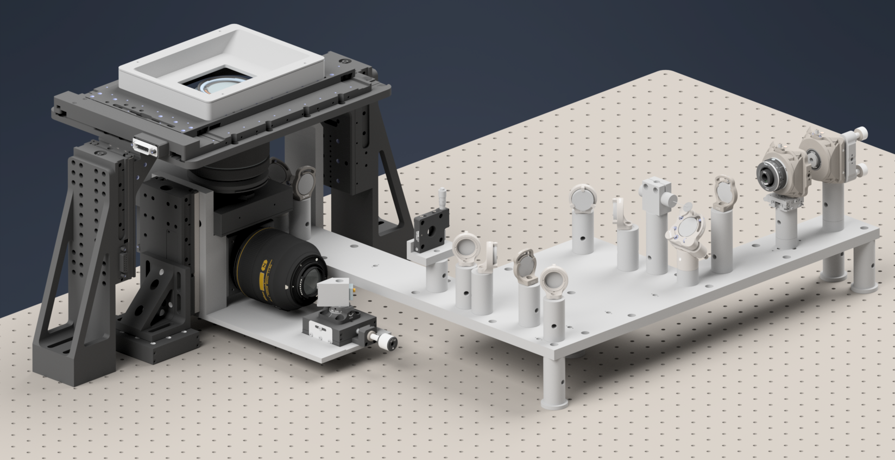

    **Figure 35:** Final assembly of the stage with the detection module mounted on it, and the stage placed over the illumination train.

The following figure shows the front view of the complete assembly where the D-Shaped mirror mounted on the oblique side plate launches the beam into the specimen sitting on the stage at an oblique angle.

.. figure:: Images/Front_View.jpg
    :align: center
    :alt: Final assembly of the stage with the detection module mounted on it, and the stage placed over the illumination train.

    **Figure 36:** Final assembly of the stage with the detection module mounted on it, and the stage placed over the illumination train.
