.. _dvopmassembly-home:

######################################
Altair-dvOPM Assembly and Alignment
######################################

Before beginning assembly, obtain the complete CAD package and machine the custom components listed in :doc:`../dvopm_cad/dvopm_cad`.

Detection Train Assembly
________________________

The detection assembly consists of a Mitakon Speedmaster 65 mm f/1.4 photographic lens serving as the primary objective (O1), followed by a 32 mm, 6-position emission filter wheel, a 90° folding mirror, a Nikon AF-S NIKKOR 85 mm f/1.4G lens serving as the secondary objective (O2), and a Ximea MU196MR-ON camera. The mechanical sequence matters because the filter wheel and the KCB2 right-angle mirror mount set the constrained spacing between O1 and O2.

Assembly proceeds in the following order:

1. Review the side and top baseplate schematics to identify the mounting holes for the filter wheel, KCB2 mirror mount, LS-50 stage, and MT1B camera stage.
2. Install the 2" fold mirror in the KCB2 mount, then fasten the KCB2 to the detection baseplate.
3. Load the emission filters into the FW-0002-6 filter wheel, attach the C60-FW adapter, and fasten the filter wheel to the baseplate.
4. Build a downward-propagating collimated reference beam from an elevated platform.
5. Use the reference beam to align the KCB2 mirror so that the incoming vertical beam is reflected along the O2 axis with correct tip, tilt, and 45° fold geometry.
6. Install the O1-side adapter stack between the C60-FW adapter and the Mitakon lens.
7. Install the O2-side SM2 adapter stack, camera stages, modified camera, and Nikon lens.
8. Use the reference beam through the filter wheel, KCB2, and O2 to set the MT1B camera focus position.
9. Mount the completed detection train to the LS-50 vertical stage for integration under the sample stage.

Detection Baseplate Hole Map
^^^^^^^^^^^^^^^^^^^^^^^^^^^^

The side face of the L-shaped detection baseplate carries the filter wheel, the KCB2 fold mirror mount, and the LS-50 vertical stage interface. The horizontal face carries the MT1B linear stage used for camera focus adjustment.

.. figure:: Images/Det_side_schematic.jpg
   :align: center
   :width: 100%
   :alt: Side schematic of the detection baseplate showing holes for the KCB2 mirror mount, filter wheel, and LS-50 stage.

   **Figure 1:** Side schematic of the detection baseplate. The colored holes indicate the KCB2 mirror mount, filter wheel, and LS-50 stage mounting locations.

.. figure:: Images/det_top_schematic.jpg
   :align: center
   :width: 100%
   :alt: Top schematic of the detection baseplate showing MT1B translation stage mounting holes.

   **Figure 2:** Top schematic of the detection baseplate. The highlighted holes are used to mount the MT1B translation stage for camera focus adjustment.

KCB2 Mirror Installation
^^^^^^^^^^^^^^^^^^^^^^^^

Install the `PF20-03-P01 2" protected silver mirror <https://www.thorlabs.com/thorproduct.cfm?partnumber=PF20-03-P01>`_ in the `KCB2 right-angle kinematic mirror mount <https://www.thorlabs.com/newgrouppage9.cfm?objectgroup_id=2792&pn=KCB2>`_ before attaching the mount to the baseplate. Load the mirror through the rear of the KCB2 and secure it with the nylon-tipped setscrew. Tighten the setscrew only enough to hold the mirror securely; excessive force can distort or damage the optic.

With the mirror installed, place the KCB2 at the indicated side-face location on the detection baseplate and fasten it from the side using a 1/4"-20 screw. While tightening the screw, place a circular bubble level on the top center of the KCB2 body. Keep the mount level as the screw is brought down to final torque. This step does not complete optical alignment, but it prevents the mount from being clamped into the baseplate with a large mechanical roll error.

Filter Wheel Installation
^^^^^^^^^^^^^^^^^^^^^^^^^

Load the required emission filters into the FW-0002-6 filter wheel before mounting it to the baseplate. Follow the loading instructions in the `ASI FW-1000 filter wheel manual <https://asiimaging.com/docs/fw_1000>`_. Install the Semrock DAPI (FF01-442/42-32), green (FF01-515/30-32), red (FF01-595/31-32), and far-red (FF01-670/30-32) emission filters.

After the filters are installed, screw the C60-FW adapter onto the top side of the filter wheel. Position the filter wheel on the detection baseplate at the indicated side-face mounting holes. As with the KCB2, use a circular bubble level at several positions on the filter wheel housing while tightening the mounting screws. The goal is for the filter wheel to sit flat against the baseplate, because it defines the mechanical entrance reference for O1 and the downstream fold mirror.

.. figure:: Images/det_kcb_fw.jpg
   :align: center
   :width: 100%
   :alt: Filter wheel and KCB2 mirror mount installed on the side of the detection baseplate.

   **Figure 3:** Filter wheel and KCB2 mirror mount installed at their designated side-face locations, shown from two viewpoints.

Reference Beam Setup
^^^^^^^^^^^^^^^^^^^^

The KCB2 mirror alignment is easiest if the detection baseplate is aligned to a straight, collimated reference beam that propagates downward from above. The logic is the same as standard two-iris beam walking, but adapted to a vertical reference leg. Thorlabs provides a useful `beam-alignment video and written guide <https://www.thorlabs.com/newgrouppage9.cfm?objectgroup_id=12211&tabname=Best+Practices>`_ for the two-iris method; the steps below describe the geometry used for this detection baseplate.

1. Place a laser source and collimator on an elevated platform above the detection baseplate. In our setup, a reflective collimator was used to produce a broad collimated reference beam.
2. Use a 1" right-angle kinematic mirror mount to fold the elevated horizontal beam downward toward the detection baseplate.
3. Mount the collimator and the fold mirror on translation stages so the beam position can be tuned without disturbing the baseplate.
4. Place two irises in the reference-beam path. Keep the iris orientation fixed during alignment so that any small decentering of the iris aperture does not move the reference.
5. Place a flat mirror at the downward beam incidence point on the optical table or baseplate plane.
6. Adjust the elevated fold mirror until the back-reflected beam retraces the incoming path through both irises. When the back-reflection remains centered through both irises, the downward beam is normal to the flat mirror and can be used as a vertical reference beam.

.. important::

   Once the two irises define the reference path, keep their positions and orientations fixed. Align the beam to the irises; do not move the irises to follow the beam.

.. figure:: Images/ref_beam.png
   :align: center
   :width: 65%
   :alt: Elevated reference-beam setup used to direct a collimated beam downward toward the detection baseplate.

   **Figure 4:** Elevated reference-beam setup used to direct a collimated beam downward toward the detection baseplate.

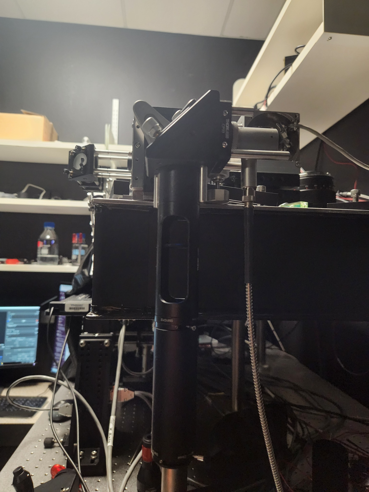

   **Figure 5:** Irises used to define and verify the reference-beam path.

.. figure:: Images/flat_mirror.png
   :align: center
   :width: 75%
   :alt: Flat mirror used for back-reflection alignment of the downward reference beam.

   **Figure 6:** Flat mirror used to check that the downward reference beam retroreflects through the alignment irises.

KCB2 Mirror Alignment
^^^^^^^^^^^^^^^^^^^^^

After the reference beam is established, use it to align the KCB2 mirror. The goal is not to measure the mirror angle with a protractor; the correct 45° fold is defined optically. A vertical reference beam entering through the filter-wheel side should reflect from the KCB2 and propagate along the horizontal O2 axis.

1. Position the detection baseplate so that the downward reference beam passes through the filter wheel entrance aperture and reaches the KCB2 mirror.
2. Place a ground-glass diffuser, pinhole, or alignment target at the filter-wheel entrance to confirm that the reference beam is centered.
3. Thread the SM2 alignment tube or temporary mirror-tube assembly into the KCB2 exit port. Use it as a visual target for the horizontal exit beam and, when needed, as a back-reflection check.
4. Adjust the KCB2 tip and tilt controls until the reflected beam is centered through the exit port and retraces the intended path.
5. Tighten the KCB2 adjuster locks gently and re-check beam centering. Locking can slightly shift the mount, so this should be done iteratively.

.. figure:: Images/filter_entrance.png
   :align: center
   :width: 75%
   :alt: Reference beam centered through the filter-wheel entrance aperture.

   **Figure 7:** Centering the reference beam through the filter-wheel entrance aperture before aligning the KCB2 mirror.

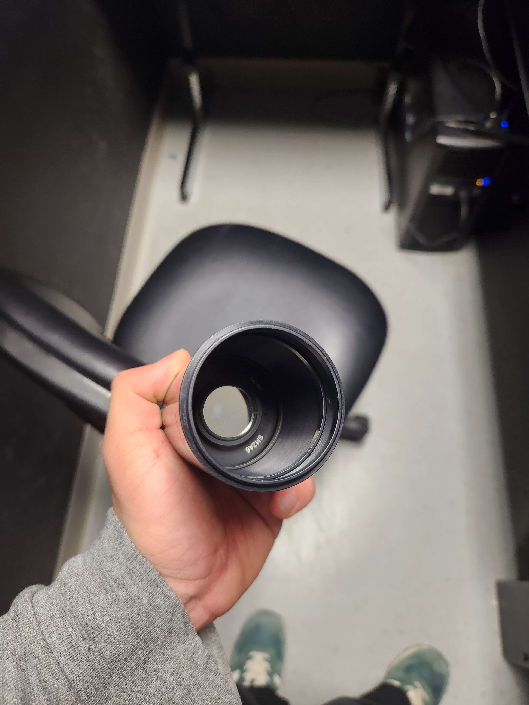

   **Figure 8:** Temporary mirror-tube assembly used to verify the KCB2 output axis by back-reflection.

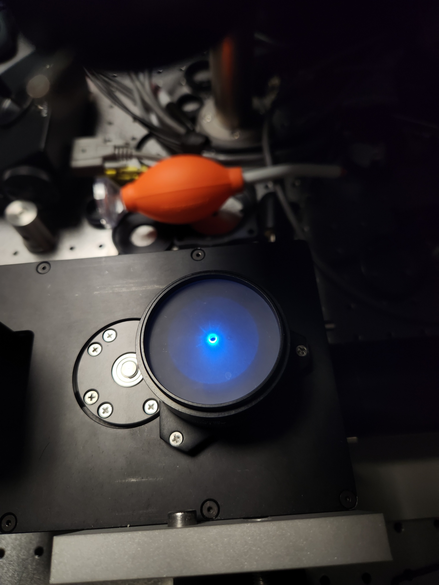

   **Figure 9:** Aligned KCB2 mirror after tip/tilt adjustment. The back-reflection is coaxial with the incident reference beam.

O1 Adapter Stack
^^^^^^^^^^^^^^^^

Once the filter wheel and KCB2 are aligned, assemble the O1-side adapter stack. Insert the custom machined 38 mm to SM2 adapter into the C60-FW adapter and tighten the C60-FW locking screws to hold the custom adapter. Thread the SM2A53 adapter onto the custom adapter. On the Mitakon O1 lens, install the 72 mm to 52 mm step-down ring, then couple the lens to the SM2A53-side adapter stack.

Set the Mitakon O1 aperture to the position corresponding to the implemented detection NA of 0.18.

Camera And O2 Preparation
^^^^^^^^^^^^^^^^^^^^^^^^^

Prepare the camera before installing O2. For the implemented microscope, the Ximea MU196MR-ON sensor cover glass was removed by Pacific Crest Imaging. After the cover glass is removed, replace the factory sensor cap with the custom-machined aluminum cap. The replacement cap preserves the full field of view when the camera is rotated.

.. important::

   Cover-glass removal exposes the image sensor and can permanently damage the camera. Have this modification performed by a professional sensor-modification service rather than attempting it during microscope assembly.

Mount the MT1B linear stage to the two highlighted holes on the horizontal detection baseplate. Mount the RP005 rotation stage on top of the MT1B. Then mount the custom machined camera holder on the RP005 rotation stage and fasten the Ximea camera into the holder. Keep the camera unrotated for the O2 focus-position step below; the final sensor angle is adjusted later during system alignment.

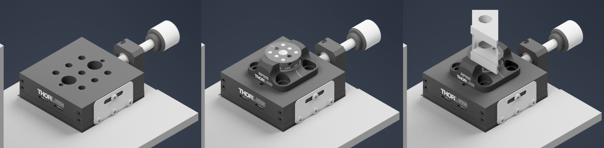

   **Figure 10:** Camera positioning stack. Mount the MT1B to the baseplate, the RP005 on the MT1B, and the custom camera holder on the RP005.

Before mounting O2, set the Nikon lens focus to infinity and fully open its aperture. Infinity focus fixes the internal focusing group position, and opening the aperture prevents the Nikon lens from clipping the relay or unintentionally setting the detection NA. The Nikon AF-S NIKKOR 85 mm f/1.4G does not have an external aperture ring, so the rear aperture lever must be held open manually. A thin, rigid shim can be used to hold the lever open, taking care not to touch the rear optical surface.

.. important::

   Set O2 to infinity focus and hold its aperture fully open before installing the lens. The rear aperture lever is difficult to access after O2 is threaded into the KCB2.

.. figure:: Images/o2_focus.png
   :align: center
   :width: 75%
   :alt: Nikon O2 lens focus ring set to infinity.

   **Figure 11:** Set the Nikon O2 focus ring to infinity before mounting the lens.

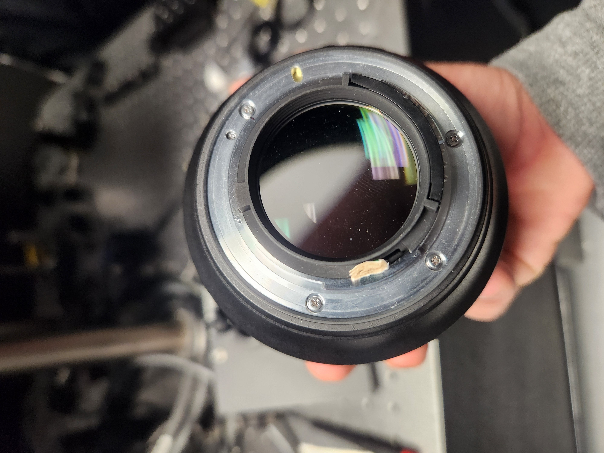

   **Figure 12:** Open the Nikon O2 aperture by holding the rear aperture lever in the fully open position.

O2 Installation And Camera Focus
^^^^^^^^^^^^^^^^^^^^^^^^^^^^^^^^

Install the O2-side adapter stack on the Nikon lens: first add the 77 mm to 52 mm step-down ring, then the 52 mm to 52 mm coupler, and then the SM2A52 adapter. Thread the prepared Nikon lens assembly into the SM2-threaded exit port of the KCB2 mount.

Use the same reference beam to set the camera focus position. Send the beam through the filter-wheel opening, KCB2 mirror, and O2 toward the camera. This check can be done with O1 removed if the Mitakon lens blocks convenient access to the filter-wheel entrance; do not disturb the C60-FW adapter or KCB2 alignment. Add neutral-density filters at the beginning of the reference beam path to avoid saturating the sensor. View the live beam image in Ximea CamTool or ``navigate`` if the acquisition configuration has already been set up. With the camera still facing straight, translate the MT1B linear stage until the spot on the camera is as small and tightly focused as possible. Lock the MT1B stage after the focus position is found.

.. figure:: Images/o2_camera.png
   :align: center
   :width: 65%
   :alt: O2 and camera setup used to locate the focused reference beam on the camera sensor.

   **Figure 13:** O2 and camera setup used to locate the MT1B focus position with the reference beam.

LS-50 Stage Mounting
^^^^^^^^^^^^^^^^^^^^

Mount the LS-50 vertical stage to the side of the detection baseplate. Insert two mounting screws through the upper side-face holes and a third screw through the lower-right side-face hole beside the KCB2. Tighten the three screws gradually, then verify that the stage moves without contacting the filter wheel, KCB2, O2, or camera assembly.

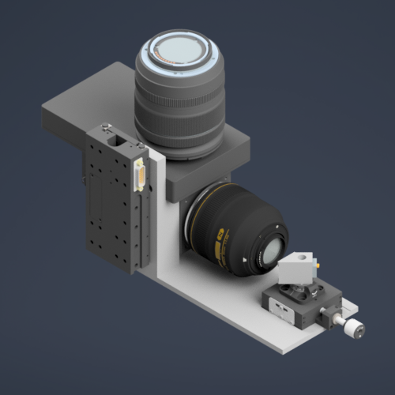

   **Figure 14:** Completed detection module with the LS-50 vertical stage mounted to the side of the baseplate.

---------------

Illumination Train Assembly
___________________________

The illumination train converts the collimated fiber output into an extended light sheet, scans it with a resonant galvanometer, relays the galvo pivot through a folded telescope, and launches the sheet obliquely toward the specimen. In optical order, the complete path is:

1. CFC11A-A fiber collimator
2. L1: LOCP-8.9R10-2.0 Powell lens
3. L2: AC254-060-A, 60 mm achromatic doublet
4. RG: CRS 4 kHz resonant galvanometer
5. POLARIS-K1S4 mirror that restores the beam orientation after the galvo
6. First folding mirror in a POLARIS-K1S4 at the corner of the baseplate
7. L3: AC254-300-A, 300 mm achromatic doublet
8. Second folding mirror in a fixed POLARIS-B1F mount
9. Third folding mirror in a fixed POLARIS-B1F mount
10. Fourth folding mirror in a POLARIS-K1S4, diagonally opposite the first corner K1S4
11. Fifth folding mirror in a fixed POLARIS-B1F mount
12. VA100CP variable slit
13. L4: AC254-250-A, 250 mm achromatic doublet
14. Upward-inverting mirror in a POLARIS-K1S4
15. PFD10-03-P01 D-shaped launch mirror

The seven 1" mirrors installed in the K1S4 and B1F mounts are PF10-03-P01 protected silver mirrors. Install each mirror without touching its optical surface and tighten the retaining screw only enough to prevent movement.

The physical installation order is deliberately different from the optical order. First establish an unobstructed reference axis using temporary alignment apertures. Next install and align the galvo and fold mirrors. Add the achromatic lenses only after the folded path is stable, and install the Powell lens and slit last. This sequence makes alignment errors easier to isolate and prevents the line-generating optics from obscuring the underlying beam axis.

This section covers mechanical assembly and geometric beam alignment. Quantitative light-sheet characterization and sample-based optimization are performed after the illumination and detection modules have been integrated.

Illumination Baseplate Hole Map
^^^^^^^^^^^^^^^^^^^^^^^^^^^^^^^

The baseplate uses dowel-pin registration and dedicated threaded holes to locate the optical mounts. The orange positions in Figure 15 are temporary alignment-aperture locations and are not occupied in the completed instrument. The two Powell-lens locations correspond to the two supported translation-stage configurations.

.. figure:: Images/Illum_base_steps_2.jpg
   :alt: Top view of the illumination baseplate with component, support, and temporary alignment-hole locations identified by color.
   :align: center
   :width: 100%

   **Figure 15:** Illumination baseplate hole map. The colored positions identify permanent components, pedestal supports, and temporary alignment-aperture locations.

Mounting Baseplate on Optical Table
^^^^^^^^^^^^^^^^^^^^^^^^^^^^^^^^^^^

.. important::

   Before mounting the pedestal post beside the first corner K1S4, insert the 1/4"-20 mounting screw for that K1S4 through the baseplate. The pedestal post blocks access to this screw after it is installed.

Support the illumination baseplate at all five gray locations shown in Figure 15 using `RS2.5P 2.5" pedestal posts <https://www.thorlabs.com/item/RS2.5P>`_. In the implemented assembly, the posts are screwed directly to the optical table. This registers the baseplate to the table-hole pattern and simplifies later coupling to the detection module. The posts can instead be clamped when direct mounting is not available.

Secure the posts to the optical table first, then lower the baseplate onto them and fasten it with 1/4"-20 cap screws. Confirm that all five posts contact the baseplate, the plate does not rock, and the previously inserted corner-K1S4 screw remains accessible.

.. figure:: Images/Baseplate_on_Table_with_Pedastal_Posts.png
   :align: center
   :alt: Illumination baseplate supported above the optical table by five pedestal posts.
   :width: 100%

   **Figure 16:** Illumination baseplate mounted on five 2.5" pedestal posts.

Fiber Collimator Assembly And Collimation
^^^^^^^^^^^^^^^^^^^^^^^^^^^^^^^^^^^^^^^^^

Assemble the source mount before connecting the laser fiber. Install the `CFC11A-A fiber collimator <https://www.thorlabs.com/thorproduct.cfm?partnumber=CFC11A-A>`_ through the AD15F2 adapter in the POLARIS-K1XY mount. Register the K1XY assembly on the 2" Polaris post and custom 0.5" spacer at the green collimator location in Figure 15. Connect the fiber with its key aligned to the collimator receptacle; do not force or rotate the connector after insertion.

Use the lowest practical laser power, appropriate wavelength-specific laser safety eyewear, and a beam block beyond the active alignment region. Place a `shear-plate interferometer <https://www.thorlabs.com/newgrouppage9.cfm?objectgroup_id=2970>`_ in the unobstructed output beam. Rotate the CFC11A-A adjustment barrel slowly until the interference fringes are straight and parallel to the shear plate's reference line. Recheck at more than one longitudinal position if space permits. This adjustment establishes collimation; do not use the K1XY controls to compensate for a divergent or convergent beam.

.. figure:: Images/LaserAlignment1.png
   :align: center
   :alt: CFC11A-A fiber collimator and shear-plate interferometer used to set output collimation.
   :width: 60%

   **Figure 17:** Shear-plate check used to adjust the CFC11A-A output to collimation.

Establishing The Reference Beam Axis
^^^^^^^^^^^^^^^^^^^^^^^^^^^^^^^^^^^^

The source-side reference axis is 3.75" above the top surface of the baseplate. Establish this axis before installing the Powell lens, achromatic lenses, galvo, or permanent fold mirrors.

Place two aperture assemblies as far apart as possible along the straight source-side path, with one near the Powell-lens location and the other at the far end of the baseplate. Either of the following aperture assemblies can be used:

- Mount a `P2000K1 2 mm pinhole <https://www.thorlabs.com/thorproduct.cfm?partnumber=P2000K1>`_, or another SM1-threaded adjustable iris, in a POLARIS-1XY on a 2.5" post.
- Mount an `ID12 iris <https://www.thorlabs.com/thorproduct.cfm?partnumber=ID12>`_ on a 3.25" post using the `custom ID12-to-Polaris adapter <https://github.com/TheDeanLab/altair/tree/main/downloads/common/cad>`_.

Set both aperture centers to 3.75" above the baseplate and fasten the aperture assemblies in place.

.. important::

   The aperture assemblies define the reference axis and must remain fixed. If a POLARIS-1XY holds an aperture, do not adjust its XY screws during alignment. Make beam-position corrections with the source POLARIS-K1XY.

Use the XY and tip/tilt controls on the source K1XY iteratively until the beam passes through both fixed apertures. Adjustable irises can be opened initially to locate the beam and then reduced gradually, but their holders must not move.

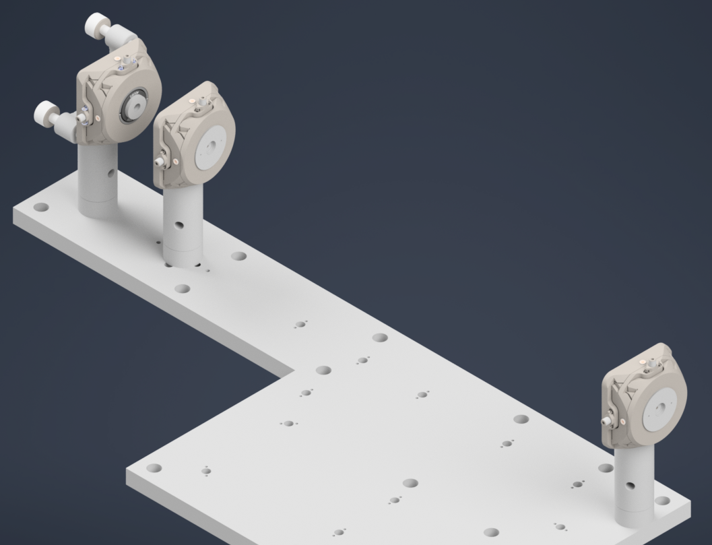

   **Figure 18:** Two-aperture setup used to establish the initial source-side beam axis.

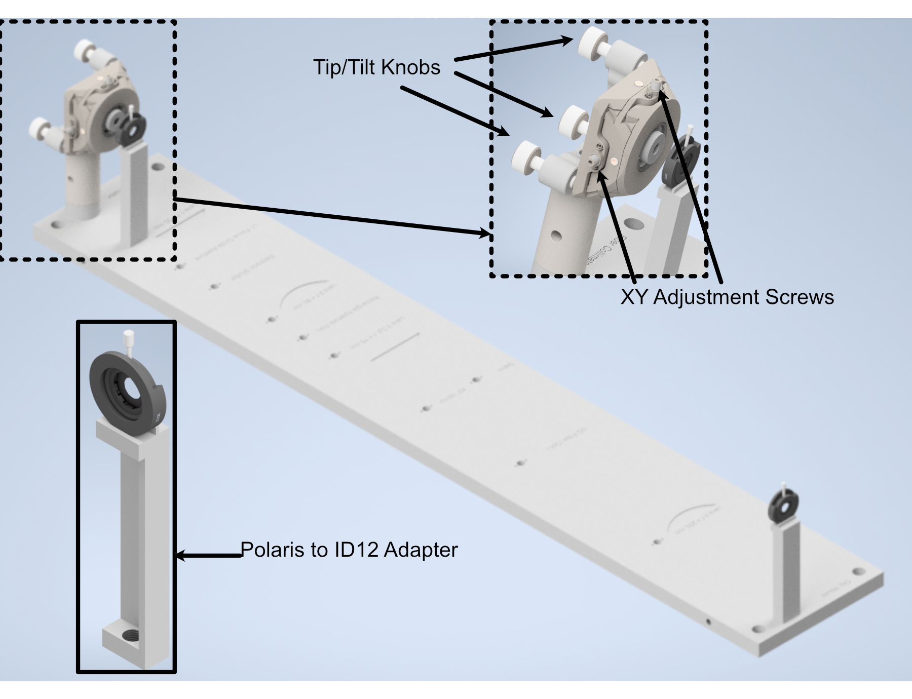

   **Figure 19:** ID12 apertures and custom adapters used to verify the beam over a long propagation distance.

Establishing The First Corner Fold
^^^^^^^^^^^^^^^^^^^^^^^^^^^^^^^^^^

Establish the first corner fold before installing the galvo and its inverting K1S4:

1. Leave the near source-axis aperture fixed and remove the farther aperture.
2. Install the first folding mirror in the corner POLARIS-K1S4 using the 1/4"-20 screw inserted before the adjacent pedestal post was mounted.
3. Set the corner K1S4 mirror center to the initial 3.75" optical-axis height.
4. Reinstall the removed aperture at the far end of the newly folded path, also at 3.75".
5. Use the tip/tilt controls on the corner K1S4 to direct the reference beam through the fixed far-end aperture.

Galvo And Inverting Mirror Alignment
^^^^^^^^^^^^^^^^^^^^^^^^^^^^^^^^^^^^

The galvo and the K1S4 immediately after it restore the required beam orientation and establish the lower folded-relay axis.

.. important::

   Lower the corner K1S4 and the far-end aperture from 3.75" to 2.75" without changing either component's lateral position. Do not recenter the aperture to follow a misaligned beam.

1. Lower the previously aligned corner K1S4 from 3.75" to 2.75".
2. Lower the fixed far-end aperture from 3.75" to 2.75" without changing its lateral position.
3. Place another fixed aperture at a 2.75" center height near the corner K1S4.
4. Register the custom galvo holder on its 3" Polaris post using the dowel pins and mounting screw.
5. Insert the CRS 4 kHz galvanometer with its reflective surface facing the incoming beam. Engage the clamp screws lightly enough that the galvo can still be rotated.
6. Install the inverting POLARIS-K1S4 and its PF10-03-P01 mirror directly after the galvo.
7. Rotate the galvo until the beam passes through the near 2.75" aperture.
8. Adjust the tip/tilt controls on the inverting K1S4 until the beam passes through the fixed far-end 2.75" aperture.
9. Iterate between galvo rotation and the inverting-K1S4 controls until the beam remains centered through both apertures. Tighten the galvo clamp screws gradually and recheck the alignment.

Folded Relay Alignment
^^^^^^^^^^^^^^^^^^^^^^

Keep the far-end 2.75" aperture in place while installing the five folding mirrors. In order, these are:

1. The corner K1S4 aligned in the preceding steps
2. A fixed B1F mirror
3. A second fixed B1F mirror
4. A K1S4 mirror diagonally opposite the first corner K1S4
5. A third fixed B1F mirror

Additional fixed apertures can be placed between the second and third folding mirrors and between the fourth and fifth folding mirrors. Use them to identify the segment at which the beam leaves the intended path; do not move an aperture to follow the beam.

Install the mirrors sequentially and confirm that the beam passes through each installed aperture. If correction is required, use the tip/tilt controls on the first corner K1S4 and the diagonally opposite fourth K1S4. Keep the three B1F mirrors fixed in their registered positions.

Achromatic Lens Installation
^^^^^^^^^^^^^^^^^^^^^^^^^^^^

Install the achromatic doublets only after the empty folded path remains centered through all alignment apertures:

- Mount L2, the AC254-060-A 60 mm lens, in a POLARIS-B1S on a 3" Polaris post.
- Mount L3, the AC254-300-A 300 mm lens, in a POLARIS-B1S on a 2" Polaris post.
- Mount L4, the AC254-250-A 250 mm lens, in a POLARIS-B1S on a 2" Polaris post.

Orient each doublet as shown in the optical schematic and CAD assembly. The lens back-reflections can be checked after installation. If a small centering correction is necessary, use only the slight mechanical play available in the corresponding lens mount while fastening it.

.. important::

   The reference beam and aligned folding mirrors remain fixed during lens installation. Do not steer the reference beam to compensate for a decentered lens.

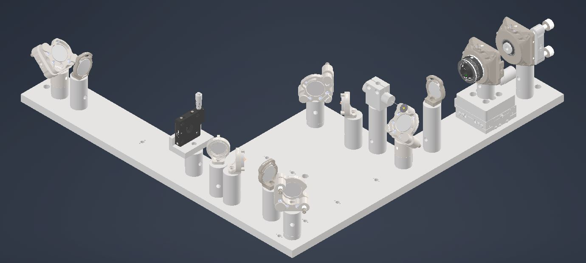

   **Figure 20:** Illumination baseplate with the folding mirrors, achromatic relay lenses, final K1S4 upward-fold assembly, and VA100CP slit installed.

Upward Fold Alignment
^^^^^^^^^^^^^^^^^^^^^

Remove the terminal temporary aperture and install the final K1S4 with its PF10-03-P01 mirror. This mirror directs the completed relay upward toward the D-shaped launch mirror.

Mount the custom vertical-target adapter to the side of the baseplate and place a `DG10-1500-H1-MD alignment target <https://www.thorlabs.com/thorproduct.cfm?partnumber=DG10-1500-H1-MD>`_ in its top opening. Adjust the final K1S4 tip and tilt until the upward beam is centered on the target. Check the target at two heights, when possible, to distinguish beam position from propagation direction.

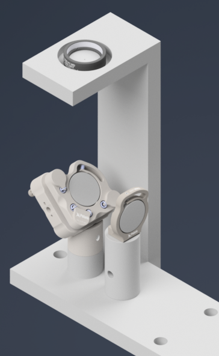

   **Figure 21:** Temporary alignment target used to center and verify the upward-propagating beam before the side plate is installed.

D-Shaped Mirror And Side Plate
^^^^^^^^^^^^^^^^^^^^^^^^^^^^^^

Select the side-plate variant before bonding the D-shaped mirror. The standard plate places the mirror at the nominal assembly position; the 1.5-cm-shorter plate leaves a slightly greater oblique propagation distance from the mirror termination to the illumination focal plane, moving the focal plane farther in both height and lateral position. Both variants are functional and can be adapted to the required focal-plane location and available clearance. See :doc:`../dvopm_cad/dvopm_cad` for the corresponding manufacturing files.

Dry-fit the PFD10-03-P01 D-shaped mirror in the machined pocket on the side plate before applying adhesive. Confirm that the mirror sits flush, its reflective face is unobstructed, and its straight edge has the orientation shown in the CAD assembly.

Bond the mirror using `Norland Optical Adhesive 81 <https://www.thorlabs.com/thorproduct.cfm?partnumber=NOA81>`_ and follow the manufacturer's handling and curing instructions:

1. Clean the machined seat and mirror edge using an optic-compatible procedure. Keep the reflective surface free of adhesive and cleaning residue.
2. Apply NOA81 to the machined seat while keeping the reflective surface free of adhesive.
3. Seat the mirror fully in the pocket and verify its orientation before curing.
4. Cure the adhesive before mounting the side plate.

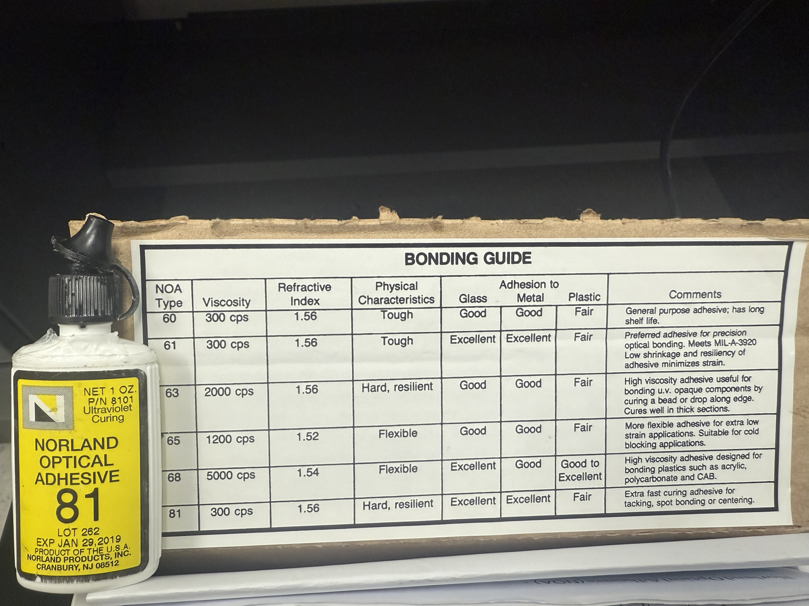

   **Figure 22:** NOA81 UV-curable optical adhesive used for the D-shaped mirror bond.

.. figure:: Images/SidePlateWithMirror.jpeg
   :align: center
   :alt: PFD10-03-P01 D-shaped mirror bonded in the machined side-plate pocket.
   :width: 75%

   **Figure 23:** PFD10-03-P01 mirror bonded into the side plate with the optical surface kept clear.

Insert the side-plate dowel pins into the main baseplate, lower the cured side plate onto the pins without contacting the upward-folding mirror, and secure it with the 1/4"-20 screws. Tighten the screws gradually and alternately so the plate seats evenly against its registration face.

The oblique face fixes the D-shaped mirror at 35° relative to the surface normal, producing an illumination launch angle of approximately 20° relative to the sample stage. Do not shim or rotate the side plate to steer the beam. If the upward beam does not strike the D-shaped mirror correctly, remove the side plate, restore the final K1S4 alignment using the temporary target, and reinstall the plate.

.. figure:: Images/K1XY_RG_K1S4_Ms_Ls_K1S4_D-M_Step_8.png
   :align: center
   :alt: Registered side plate with bonded D-shaped launch mirror installed above the upward-fold mirror.
   :width: 50%

   **Figure 24:** Side plate registered to the main baseplate above the upward-folding mirror. The machined oblique face establishes the final launch geometry.

Powell Lens Assembly
^^^^^^^^^^^^^^^^^^^^

The LOCP-8.9R10-2.0 Powell lens generates the extended line profile. Install it after the circular-beam path has been aligned. Either the LNR25M-based configuration or the XP10X-based configuration can be adapted to provide axial translation; the steps below demonstrate the LNR25M configuration. In both configurations, the POLARIS-1XY centers the lens on the beam and the LRM1 sets the fan orientation.

**1. Secure the Powell lens in the AD9F.**

Place clean optical tissue on the work surface and rest the flat face of the Powell lens on the tissue. Position the smaller end of the AD9F flush with the flat lens face, then tighten the two retaining screws evenly and only enough to prevent lens motion.

.. card:: Powell Lens into AD9F Assembly

   .. raw:: html

      <video controls style="width:50%;">
        <source src="../PowellAD9F.mp4" type="video/mp4">
        your browser doesn't support video
      </video>

**2. Install the LRM1 in the POLARIS-1XY.**

Thread the LRM1 into the POLARIS-1XY until the rear surface of the LRM1 is flush with the front of the 1XY mount. Leave the LRM1 rotation adjustment accessible.

**3. Register the LNR25M on the baseplate.**

Place the LNR25M at the light-green Powell configuration-1 location in Figure 15. Engage both 3 mm dowel pins before installing screws. Depending on access, secure the stage through the two top-access holes or through the corresponding baseplate holes into the bottom of the stage. Confirm that the translation axis is parallel to the incoming beam before final tightening.

**4. Attach the Polaris post to the custom LNR25M adapter.**

Register the 1" Polaris post on the custom adapter using the two 2 mm dowel pins. Insert the 1/4"-20 screw from the underside of the adapter and tighten it into the post.

**5. Attach the custom adapter to the LNR25M.**

Place the adapter on the LNR25M and secure it through the four holes surrounding the post. Tighten the screws in a crossing pattern to keep the post square to the stage.

**6. Install the POLARIS-1XY.**

Register the POLARIS-1XY on the post using the 2 mm dowel pins and secure it with the 8-32 screw.

**7. Install and align the Powell lens.**

Thread the AD9F containing the Powell lens fully into the LRM1. At reduced laser power, use the 1XY controls to center the Powell lens on the incoming beam and rotate the LRM1 until the generated line has the required orientation. Use the LNR25M for axial positioning. After an axial adjustment, recheck lens centering and line orientation.

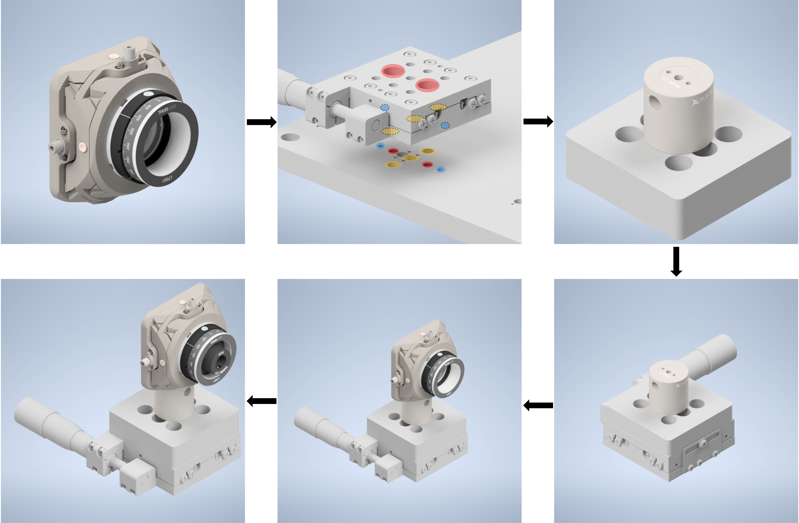

   **Figure 25:** LNR25M-based Powell-lens assembly. The panels show the LRM1 and POLARIS-1XY assembly, LNR25M registration, custom post adapter, and completed positioning assembly.

For configuration 2, use the XP10X stage with the XP10-C1 actuator at the yellow-green Powell location in Figure 15. Register a 1.5" Polaris post and custom height adapter on the baseplate, fasten the XP10X to the post using its dowel pins and 1/4"-20 screw, and mount the POLARIS-1XY on the moving platform of the XP10X using dowel pins and an 8-32 screw. The Powell lens, AD9F, and LRM1 assembly is otherwise unchanged.

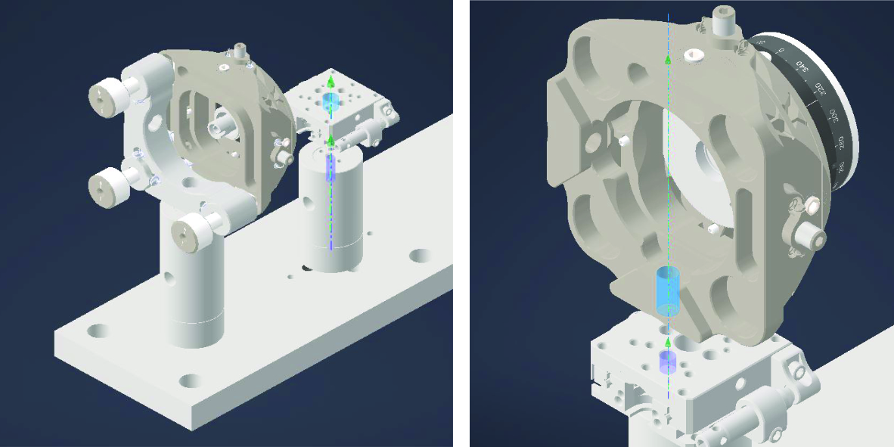

   **Figure 26:** Alternate XP10X-based Powell-lens positioning configuration.

Mechanical Slit Assembly
^^^^^^^^^^^^^^^^^^^^^^^^

The VA100CP slit is positioned at the designated plane within the 300 mm/250 mm relay and controls the effective illumination numerical aperture. It should clip the beam symmetrically; it is not a steering element.

1. Fasten the VA100CP to the custom slit adapter with the 3/8" screw.
2. Register the custom adapter on the Polaris post using the dowel pins and secure it with the 3/8" screw.
3. Register the post on the baseplate and secure it with the 1/4"-20 screw.
4. Begin with the slit fully open and verify that the established beam passes through the opening. Close the slit gradually and confirm that both edges clip the beam symmetrically.

Use the Powell translation stage only to adjust the axial position of the Powell lens. After an axial adjustment, recheck the Powell-lens orientation and the downstream beam profile.

.. important::

   The slit is an aperture, not a steering element. Do not use the Powell-lens XY controls to force a laterally offset beam through the slit.

.. figure:: Images/Slit_on_Baseplate_Steps.jpg
   :align: center
   :alt: VA100CP mechanical slit attached to its custom adapter and registered on the illumination baseplate.
   :width: 100%

   **Figure 27:** VA100CP slit and custom mounting sequence.

Final Illumination Alignment Check
^^^^^^^^^^^^^^^^^^^^^^^^^^^^^^^^^^

Before coupling the illumination module to the microscope, perform a complete low-power alignment check:

1. Confirm collimation at the CFC11A-A with the shear plate.
2. Verify that the beam remains centered on the galvo, the inverting K1S4, and all five folding mirrors.
3. Check the achromatic-lens back-reflections and confirm that the beam passes through L2, L3, and L4 without changing the established reference alignment.
4. Verify that the final K1S4 sends the beam vertically through the temporary target and onto the D-shaped mirror.
5. Confirm that the Powell lens is centered and rotated to the required line orientation.
6. Close the VA100CP gradually and confirm symmetric clipping.
7. Tighten adjuster locks and stage locks incrementally, rechecking the next downstream element after each lock is engaged.

Figure 28 shows the completed illumination assembly. Light-sheet thickness, extent, and uniformity are evaluated later during characterization.

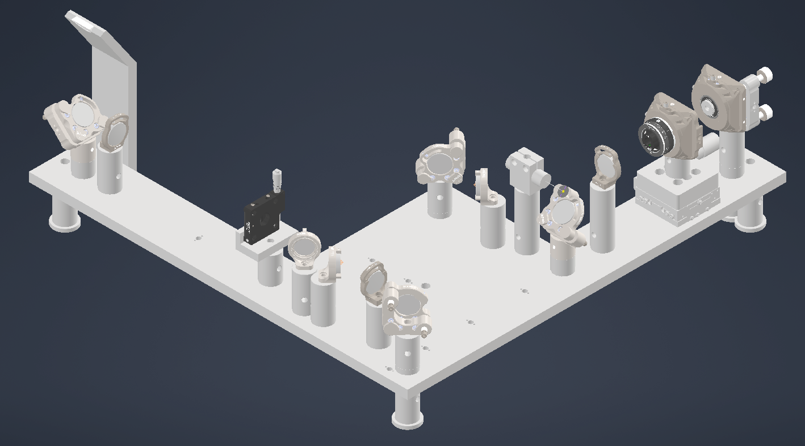

   **Figure 28:** Completed illumination train with the folded relay, Powell-lens assembly, slit, upward fold, and side plate installed.

System Integration and Assembly Completion
^^^^^^^^^^^^^^^^^^^^^^^^^^^^^^^^^^^^^^^^^^

The sample-stage structure integrates the two independently assembled modules. The implemented structure uses the S561-2235B flat-top stage, the Dual-LS-50-FTP with LS-5007 actuators, and two LS-5008-K right-angle brackets. Use the project-specific stage drawing supplied by ASI as the mechanical reference. Related S561 and Dual-LS-50-FTP drawings are available in the `ASI technical-drawing archive <https://www.asiimaging.com/support/technical-drawings/>`_, and the `ASI LS-50 manual <https://docs.asiimaging.com/ls50>`_ covers stage installation and operation.

Complete the mechanical integration in the following order:

1. Assemble the flat-top stage, paired LS-50 actuators, and LS-5008-K brackets according to the ASI drawing and installation instructions.
2. Position the stage structure over the terminal end of the illumination baseplate. Before fastening it to the optical table, confirm that the illumination side plate and D-shaped mirror remain accessible.
3. Mount the detection module beneath the sample stage using the `PT1B translation stage <https://www.thorlabs.com/thorproduct.cfm?partnumber=PT1B>`_ and `MSAP90 right-angle bracket <https://www.thorlabs.com/thorproduct.cfm?partnumber=MSAP90>`_.
4. Use the PT1B adjustment to place O1 beneath the open region of the sample stage. Do not set the final illumination-to-detection registration at this step.
5. Check the intended travel of the sample stage and detection LS-50 at low speed. Confirm that the stage structure, O1, filter wheel, KCB2, camera assembly, illumination side plate, and D-shaped mirror do not contact one another.
6. At reduced excitation power, confirm that the D-shaped mirror directs the illumination beam past O1 without clipping.

.. important::

   Establish mechanical clearance before commanding motorized motion over the full travel range. Stop the stage immediately if any component approaches O1, the D-shaped mirror, the side plate, or the detection baseplate.

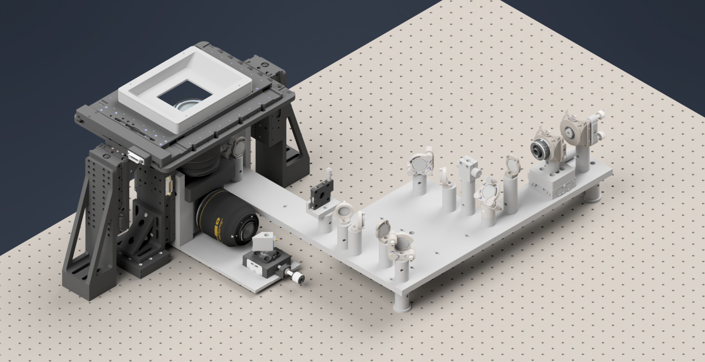

   **Figure 29:** Stage structure integrating the illumination baseplate and the detection module.

Figure 30 shows the front-view launch geometry. The final K1S4 directs the beam upward, and the D-shaped mirror on the oblique side plate redirects it toward the specimen at approximately 20° relative to the stage.

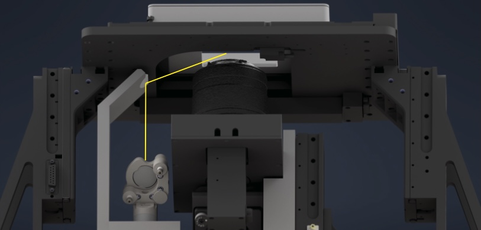

   **Figure 30:** Front view of the integrated microscope and the final oblique illumination launch path.

Assembly Completion Checklist
^^^^^^^^^^^^^^^^^^^^^^^^^^^^^

The optomechanical assembly is ready for system alignment when all of the following checks pass:

- The detection filter wheel and KCB2 are seated flat against the detection baseplate, and the KCB2 adjuster locks are engaged after alignment.
- O1 is set to NA = 0.18. O2 is set to infinity focus and its aperture is held fully open.
- The MT1B camera-focus position is locked. The RP005 remains available for the later camera-angle alignment.
- The detection baseplate is fastened to its LS-50 stage at all three designated mounting points.
- All five illumination-baseplate pedestal posts are secured, and the baseplate does not rock.
- The galvo clamp is secure, the three B1F mounts remain fixed, and the adjustable K1S4 mounts retain the aligned beam path after their locks are engaged.
- L2, L3, and L4 remain centered on the established beam path after their mounts are tightened.
- The VA100CP opens and closes without moving its registered mount, and the beam is clipped symmetrically as the slit closes.
- The temporary alignment apertures and vertical target have been removed from positions occupied by the completed optical train.
- The illumination side plate is fully seated on its dowel pins and the bonded D-shaped mirror is unobstructed.
- The sample-stage structure and detection module complete their intended travel without mechanical contact.
