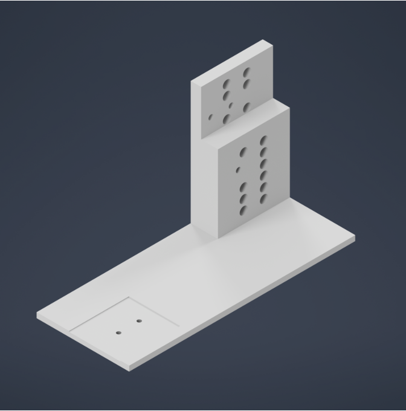
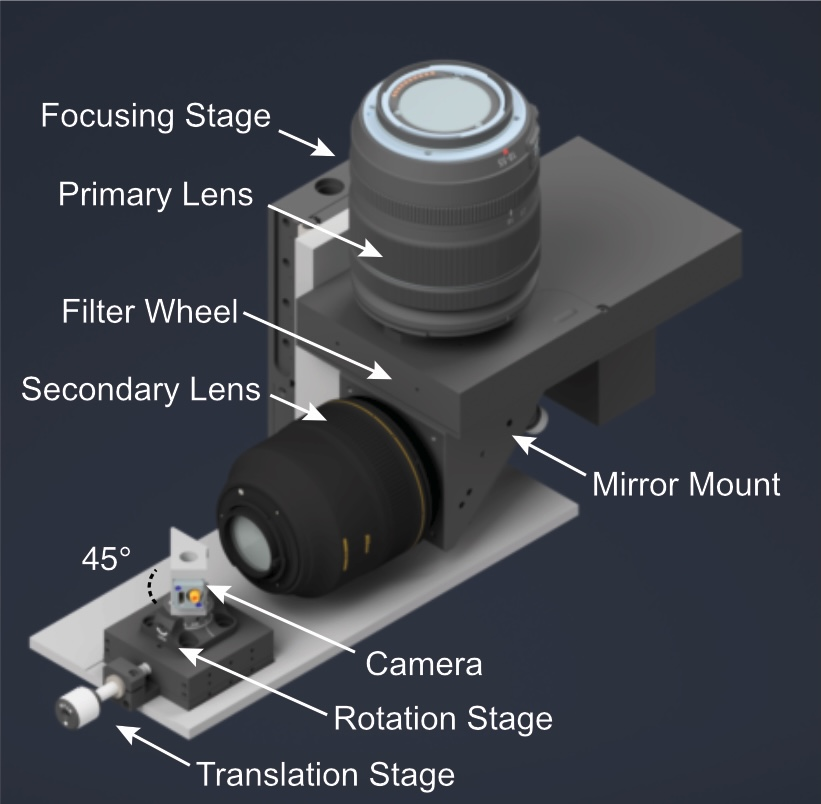
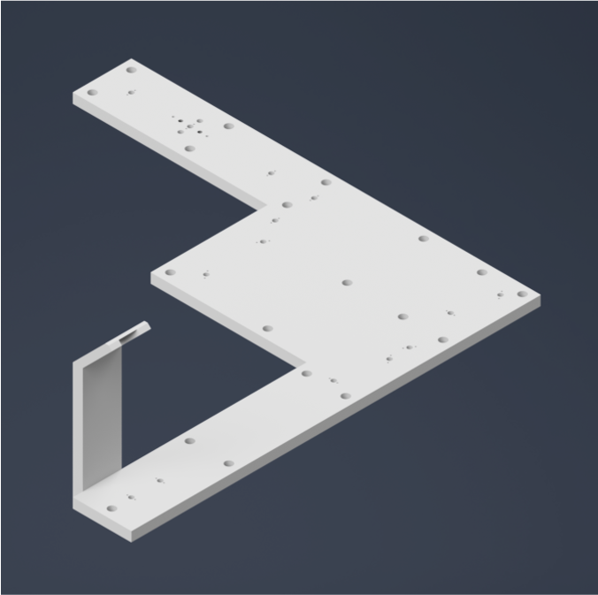
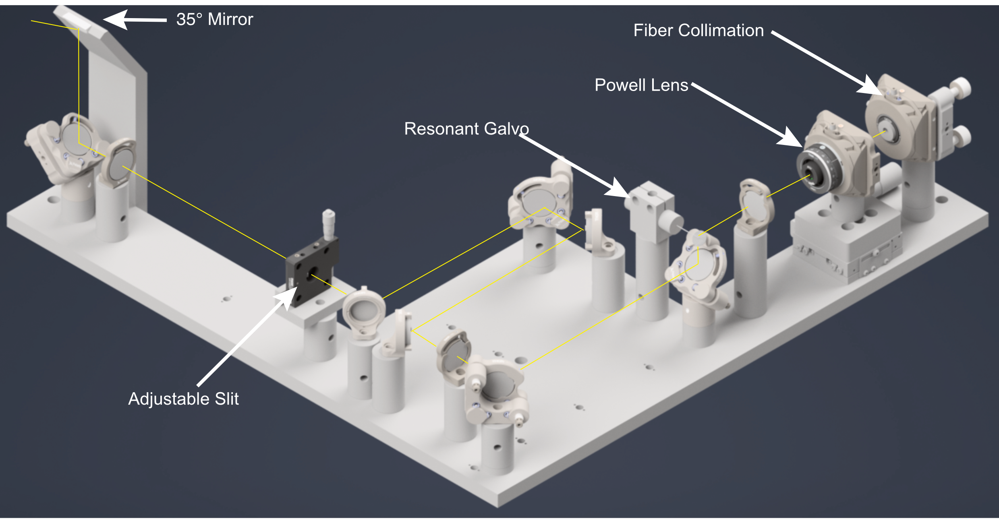
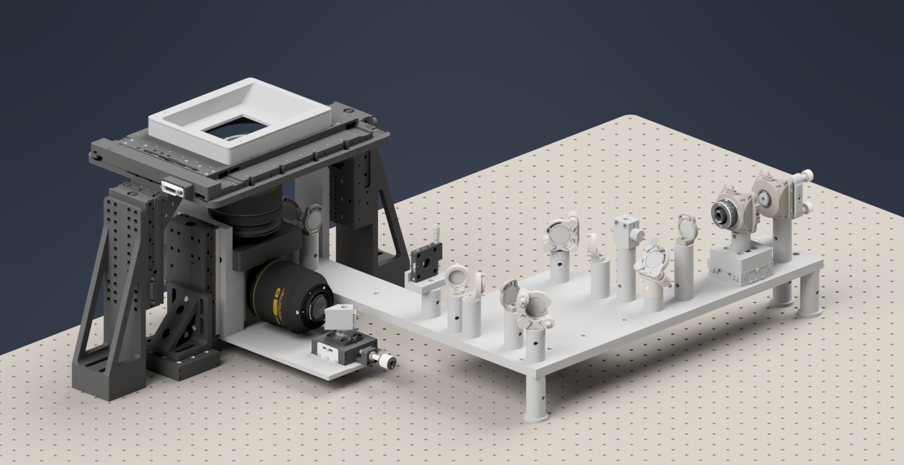

.. _dvopmbaseplatedesign-home:

################
Baseplate Design
################

The optical simulations described in the previous section define the distances, angles, and clearances needed for the dvOPM detection and illumination paths. The baseplate design translates those optical constraints into a mechanically reproducible instrument. In this context, "baseplate design" includes more than the machined plates themselves: it includes component placement, folded beam geometry, custom adapters, stage integration, and the limited set of adjustment axes required for alignment.

The guiding principle is to constrain geometry that should remain fixed while preserving only the degrees of freedom needed to align the microscope. This makes the system practical to assemble and repeat, while still respecting the mechanically constrained optical layouts used in the Zemax models.

Detection Path: Baseplate Design
________________________________

The detection subsystem was translated from the Zemax model into a dedicated baseplate assembly. The purpose of this baseplate is not only to hold the optical components, but to preserve the optimized relay geometry in a form that is mechanically reproducible and practical to align.

The relay is implemented as a folded geometry using a 90° beam fold. O1 is positioned to collect the emitted fluorescence from below the specimen and direct it through the emission filter wheel region toward the fold mirror. The kinematic mirror mount then redirects the beam so that O2 can be positioned orthogonally to O1. This folded arrangement allows the compact relay architecture to be physically realized while still accommodating the required components within the optical path.

The filter wheel occupies the region between O1 and the folded portion of the relay, and because it imposes a minimum spacing requirement, it directly affects the mechanical placement of adjacent components on the baseplate. Likewise, the kinematic mirror mount defines another minimum spacing region that must be respected when placing O2.

The entire detection module is mounted on a vertical translation stage so that the imaging plane can be adjusted relative to the specimen for focusing. At the camera end, a manual linear stage provides fine axial adjustment, and a rotary stage enables alignment of the camera sensor to the tilted image plane. These degrees of freedom are essential, since the optical performance of the system is particularly sensitive to the O2-to-camera distance and camera angle, as observed during the Zemax optimization.

The baseplate therefore has a dual purpose. First, it constrains the relative positions of the major relay elements so that the optimized optical geometry can be reproduced. Second, it preserves the specific alignment degrees of freedom that are still required in the physical system. This reflects the core Altair design principle: constrain what should be fixed, and preserve only the adjustments that are necessary for achieving optimal performance.

   **Figure 1:** CAD rendering of the detection baseplate showing component placement and folded relay geometry.

   **Figure 2:** Isometric view of the assembled detection subsystem.

------------------------------

Illumination Path: Baseplate Design
___________________________________

The illumination subsystem was similarly translated from the Zemax design into a dedicated baseplate assembly. As with the detection subsystem, the goal of the baseplate is to make the optimized optical geometry physically realizable, stable, and reproducible.

The illumination path is implemented as a sequence of mounted optical elements arranged primarily on a common planar baseplate. This reflects a key design decision: the use of longer focal length achromatic doublets allows the lenses to be kept in a consistent orientation on the same baseplate while still providing sufficient propagation distance to shape the beam into the required light sheet at the stage.

Because the relay uses longer focal length lenses, the physical optical path becomes relatively long. To prevent the footprint from becoming impractically large, the beam is folded using mirrors in the physical system. This beam folding is therefore not an incidental feature, but a direct mechanical consequence of the long-focal-length design choice made to satisfy both optical and integration requirements.

Near the end of the illumination path, the beam must leave the planar relay geometry and be directed upward toward the sample. This is achieved using a vertical inversion mirror followed by a final inclined mirror that launches the beam toward the specimen at approximately 20° relative to the stage. This final section is particularly important, as it represents the point where the optical relay geometry and the physical stage geometry intersect. The baseplate and mounting configuration must therefore preserve not only the lens spacings, but also the correct beam height and launch angle.

Two functional side-plate variants are provided for the D-shaped launch mirror. The standard plate places the mirror at the nominal assembly position. A second plate is 1.5 cm shorter, leaving a slightly greater oblique propagation distance between the mirror termination and the illumination focal plane; the focal plane is therefore farther from the mirror in both height and lateral position. Either plate can be used or adapted to suit the required focal-plane position and mechanical clearance. Manufacturing files for both variants are listed in :doc:`../dvopm_cad/dvopm_cad`.

The illumination baseplate design thus extends beyond simply placing optical elements in sequence. It must coordinate planar relay optics, beam folding, vertical redirection, final launch geometry, and stage height constraints within a single mechanically stable system. As a result, this subsystem represents one of the most integration-intensive aspects of the overall instrument design.

   **Figure 3:** CAD rendering of the illumination baseplate showing folded beam path and component layout.

   **Figure 4:** Isometric view of the assembled illumination subsystem.

------------------------------

System Integration and Stage
____________________________

Before presenting the complete system assembly, it is useful to describe how the optical subsystems integrate with the stage, since the system operates in a stage-scanning acquisition geometry.

The illumination and detection baseplates are mounted on the optical table as mechanically registered subsystems. During setup and alignment, the detection module can still be positioned for focus and the camera can be adjusted relative to the tilted image plane. Once aligned, however, the optical subsystems remain fixed during volumetric acquisition. The sample is mounted above them on a motorized stage and translated through the stationary illumination and detection planes.

The stage hardware used in this implementation is included in the EBOM below. The emphasis here is on the system-level relationship: the optical geometry is held fixed during imaging, while the stage provides controlled motion of the sample.

This arrangement separates optical alignment from volumetric acquisition. Once the detection and illumination paths are aligned on their respective baseplates, volumetric imaging is achieved entirely through stage motion rather than through repeated adjustment of the optical system. This significantly improves both stability and repeatability.

The complete system assembly can therefore be understood as the integration of three primary components: the detection baseplate, the illumination baseplate, and the motorized stage positioned above them.

   **Figure 5:** Complete Altair-dvOPM system assembly showing integration of detection, illumination, and stage subsystems.

------------------------------

Engineering Bill of Materials
_____________________________

Baseplate design is also the point where the optical layout becomes a build package. For that reason, the engineering bill of materials (EBOM) is included here as a procurement-level summary of the detection and illumination trains, including optics, optomechanics, stages, controllers, and custom machined parts. The complete assembly folder, individual manufacturing files, required quantities, and purpose of each custom component are provided in :doc:`../dvopm_cad/dvopm_cad`.

The following EBOM tables list the components used in the detection and illumination trains. Costs are approximate and may change with vendor, availability, and configuration. Totals are calculated as quantity multiplied by unit cost for each listed line item. The laser source is listed for completeness, but its cost is not included in the illumination train total.

.. collapse:: Detection Train EBOM (total: $27,595.12)

    Detection train total (Qty x Unit Cost): **$27,595.12**.

    .. list-table:: Table S2. Detection train EBOM.
       :header-rows: 1
       :widths: 24 14 8 12 42
    
       * - Part Number
         - Source
         - Qty
         - Unit Cost
         - Description
       * - **Optics**
         -
         -
         -
         -
       * - Mitakon Speedmaster 65 mm f/1.4
         - Mitakon
         - 1
         - $599.00
         - Fast photographic lens
       * - AF-S NIKKOR 85 mm f/1.4G
         - Nikon
         - 1
         - $1159.95
         - Fast photographic lens
       * - MU196MR-ON
         - Ximea
         - 1
         - $1100.00
         - Monochrome camera, AR2020 sensor
       * - FW-0002-6
         - ASI
         - 1
         - $3700.00
         - High-speed motorized filter wheel
       * - FF01-442/42-32
         - Semrock
         - 1
         - $380.63
         - DAPI emission filter
       * - FF01-670/30-32
         - Semrock
         - 1
         - $380.63
         - Far-red filter
       * - FF01-515/30-32
         - Semrock
         - 1
         - $380.63
         - Green filter
       * - FF01-595/31-32
         - Semrock
         - 1
         - $380.63
         - Red filter
       * - PF20-03-P01
         - Thorlabs
         - 1
         - $115.68
         - Ø2" protected silver mirror
       * - **Optomechanics**
         -
         -
         -
         -
       * - C60-FW
         - ASI
         - 1
         - $100.00
         - Filter wheel adapter
       * - KCB2
         - Thorlabs
         - 1
         - $204.38
         - Kinematic mirror mount
       * - SM2A52
         - Thorlabs
         - 1
         - $25.29
         - SM2 to M52 adapter
       * - SM2A53
         - Thorlabs
         - 1
         - $25.29
         - M52 to SM2 adapter
       * - 77 mm to 52 mm lens adapter
         - Generic
         - 1
         - $9.99
         - 77 mm to 52 mm step-down ring
       * - 72 mm to 52 mm lens adapter
         - Generic
         - 1
         - $6.79
         - 72 mm to 52 mm step-down ring
       * - 52 mm to 52 mm lens adapter
         - Generic
         - 1
         - $5.95
         - 52 mm male-to-male coupler
       * - MSAP90
         - Thorlabs
         - 1
         - $55.83
         - Right-angle plate
       * - **Stages**
         -
         -
         -
         -
       * - S561-2235B
         - ASI
         - 1
         - $8200.00
         - Flat-top stage
       * - Dual-LS-50-FTP
         - ASI
         - 1
         - $5100.00
         - Two parallel actuators with LS-5007
       * - LS-5008-K
         - ASI
         - 2
         - $700.00
         - 90° brackets for Dual-LS-50-FTP
       * - LS-50-AMERL
         - ASI
         - 1
         - $2550.00
         - Motorized linear stage
       * - MT1B
         - Thorlabs
         - 1
         - $278.36
         - Manual linear stage
       * - RP005
         - Thorlabs
         - 1
         - $99.69
         - Manual rotation stage
       * - PT1B
         - Thorlabs
         - 2
         - $268.20
         - Manual linear stage
       * - **Machined Parts**
         -
         -
         -
         -
       * - Baseplate
         - Xometry
         - 1
         - $300.00
         - L-shaped main baseplate
       * - Custom Adapter
         - Xometry
         - 1
         - $100.00
         - 38 mm to SM2 adapter
       * - Custom Camera Holder
         - Xometry
         - 1
         - $200.00
         - Holder for camera
       * - Custom Camera Cap
         - Xometry
         - 1
         - $200.00
         - Redesigned camera cap

.. collapse:: Illumination Train EBOM (total excluding laser: $32,673.87)

    Illumination train total, excluding laser source (Qty x Unit Cost): **$32,673.87**.

    .. list-table:: Table S3. Illumination train EBOM.
       :header-rows: 1
       :widths: 24 14 8 12 42
    
       * - Part Number
         - Source
         - Qty
         - Unit Cost
         - Description
       * - **Optics**
         -
         -
         -
         -
       * - AC254-060-A
         - Thorlabs
         - 1
         - $95.34
         - Achromatic doublet lens, f = 60 mm
       * - AC254-250-A
         - Thorlabs
         - 1
         - $95.34
         - Achromatic doublet lens, f = 250 mm
       * - AC254-300-A
         - Thorlabs
         - 1
         - $95.34
         - Achromatic doublet lens, f = 300 mm
       * - PF10-03-P01
         - Thorlabs
         - 7
         - $36.89
         - Ø1" protected silver mirror
       * - LOCP-8.9R10-2.0
         - Laserline
         - 1
         - $240.00
         - Powell lens for line generation
       * - PFD10-03-P01
         - Thorlabs
         - 1
         - $71.50
         - Ø1" protected silver D-shaped mirror
       * - **Optomechanics**
         -
         -
         -
         -
       * - PLS-P150
         - Thorlabs
         - 4
         - $39.10
         - Polaris post, 1.5"
       * - PLS-P2
         - Thorlabs
         - 3
         - $42.00
         - Polaris post, 2"
       * - PLS-P3
         - Thorlabs
         - 3
         - $46.12
         - Polaris post, 3"
       * - POLARIS-K1XY
         - Thorlabs
         - 1
         - $1473.39
         - XY kinematic mount
       * - POLARIS-1XY
         - Thorlabs
         - 3
         - $1088.67
         - Compact XY mount
       * - POLARIS-B1F
         - Thorlabs
         - 3
         - $170.26
         - Fixed mount base
       * - POLARIS-B1S
         - Thorlabs
         - 3
         - $119.50
         - Slim mount base
       * - POLARIS-MA45
         - Thorlabs
         - 2
         - $53.69
         - 45° adapter
       * - POLARIS-K1S4
         - Thorlabs
         - 4
         - $198.35
         - Kinematic mount for 1" optics
       * - CRS 4KHz Galvo Scanner
         - Novanta
         - 1
         - $3700.00
         - Resonant galvanometer
       * - VA100CP
         - Thorlabs
         - 1
         - $321.57
         - Variable mechanical slit
       * - CFC11A-A
         - Thorlabs
         - 1
         - $338.29
         - Fiber collimator
       * - LRM1
         - Thorlabs
         - 1
         - $109.65
         - Lens adapter
       * - AD9F
         - Thorlabs
         - 1
         - $33.65
         - Thread adapter
       * - AD15F2
         - Thorlabs
         - 1
         - $36.70
         - SM15 adapter
       * - P2000K1
         - Thorlabs
         - 1
         - $87.74
         - 2 mm pinhole
       * - RS2.5P
         - Thorlabs
         - 5
         - $35.91
         - 2.5" pedestal post
       * - **Stages**
         -
         -
         -
         -
       * - XP10X & XP10-C1
         - Thorlabs
         - 1
         - $710.00
         - Manual linear stage and actuator
       * - LNR25M
         - Thorlabs
         - 1
         - $828.75
         - Manual linear stage
       * - **Controllers / Others**
         -
         -
         -
         -
       * - LightHUB Ultra-007C
         - Omicron
         - 1
         - Not included
         - Laser source; listed for completeness and excluded from total
       * - TG8-BASIC
         - ASI
         - 1
         - $5425.00
         - Tiger controller
       * - PXIe-1073
         - NI
         - 1
         - $3104.00
         - PXI chassis
       * - PCIe-8361
         - NI
         - 1
         - $1186.00
         - PCIe module
       * - PXIe-6259
         - NI
         - 1
         - $3472.00
         - Multifunction I/O card (779778-01)
       * - PXI-6733
         - NI
         - 1
         - $3405.00
         - Analog output card (778512-01)
       * - **Machined Parts**
         -
         -
         -
         -
       * - Baseplate
         - Xometry
         - 1
         - $750.00
         - L-shaped main baseplate
       * - Side Plate
         - Xometry
         - 1
         - $300.00
         - Attachment to the main baseplate
       * - Custom Holder for Galvo
         - Xometry
         - 1
         - $100.00
         - Holder for galvanometer
       * - Custom Holder for Slit
         - Xometry
         - 1
         - $100.00
         - Holder for mechanical slit
       * - Custom Spacer (K1S4)
         - Xometry
         - 2
         - $100.00
         - 0.75" spacer for K1S4
       * - Custom Spacer (K1S4)
         - Xometry
         - 2
         - $100.00
         - 0.25" spacer for K1S4
       * - Custom Adapter (1XY)
         - Xometry
         - 1
         - $200.00
         - Adapter for LNR25M-1XY
       * - Custom Spacer (K1XY)
         - Xometry
         - 1
         - $100.00
         - 0.5" spacer for K1XY
