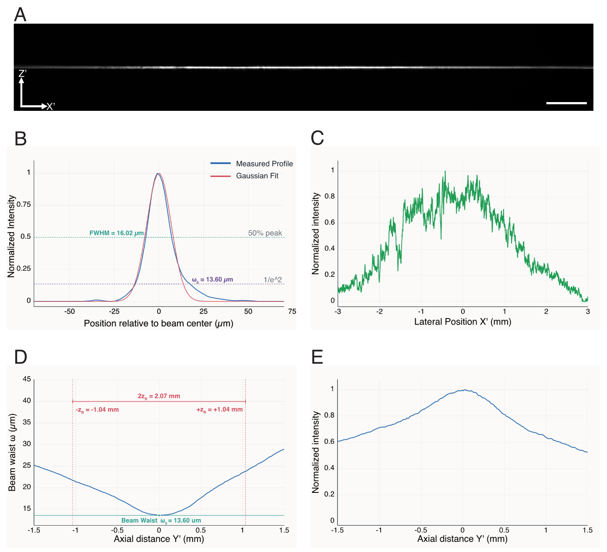
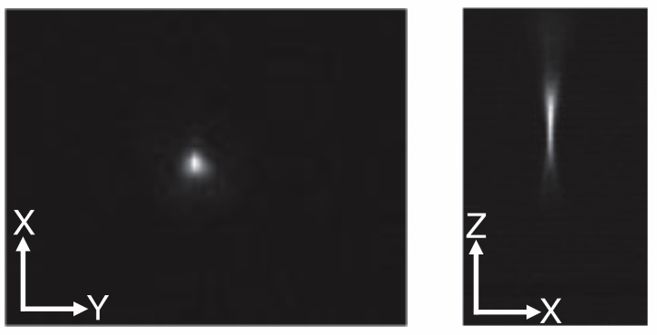
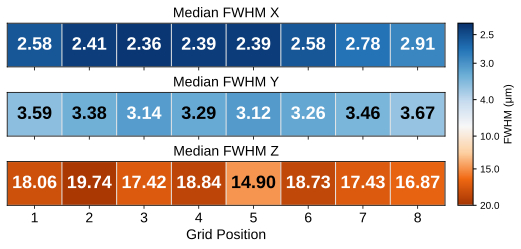

.. _dvopmcharacterization-home:

##############################
Altair-dvOPM Characterization
##############################

This section describes the experimental measurements used to characterize the assembled Altair-dvOPM. The illumination measurement quantifies the light-sheet thickness, lateral extent, and propagation in air. The detection measurement uses fluorescent beads to estimate three-dimensional imaging resolution and its variation across the field of view.

The coordinate notation follows the :doc:`system overview <../dvopm_overview/dvopm_overview>`. In the oblique image coordinate system, :math:`X'` is the long lateral axis of the light sheet, :math:`Y'` is the light-sheet propagation direction, and :math:`Z'` is the sheet-thickness direction.

------------------------------

Illumination Characterization
_____________________________

Measurement Setup
^^^^^^^^^^^^^^^^^

The illumination beam was measured directly in air after the final achromatic doublet, L4. For this measurement, the beam was not redirected upward by the final folding optics. Instead, it passed through neutral-density filters and propagated directly onto the sensor of a Ximea MU196MR-ON camera mounted on an MP-285 motorized stage.

Images were acquired around the beam focal plane at :math:`10~\mu\mathrm{m}` increments along :math:`Y'`. The camera region of interest retained the full horizontal dimension of the light sheet so that sheet thickness and lateral extent could be evaluated from the same acquisition.

Beam Analysis Method
^^^^^^^^^^^^^^^^^^^^

Sheet thickness was measured from vertical intensity profiles along :math:`Z'`. To reduce sensitivity to an individual camera column, the analysis used the average profile from a 21-column window centered on a selected column within the central region of the beam. The same column window was applied to every axial frame.

For each frame, the background-corrected vertical profile was fit with a Gaussian. The fitted standard deviation in pixels, :math:`\sigma_{\mathrm{px}}`, was converted to FWHM using the calibrated camera sampling of :math:`1.4~\mu\mathrm{m\,pixel^{-1}}`:

.. math::

   \mathrm{FWHM} = 2.35\,\sigma_{\mathrm{px}}\left(1.4~\mu\mathrm{m\,pixel^{-1}}\right).

The focal plane was defined as the axial frame with the minimum fitted FWHM. The Gaussian :math:`1/e^2` intensity radius, :math:`w_0`, was calculated from that minimum:

.. math::

   w_0 = \frac{\mathrm{FWHM}}{\sqrt{2\ln 2}} \approx \frac{\mathrm{FWHM}}{1.177}.

The Rayleigh length was then calculated at :math:`\lambda=561~\mathrm{nm}`:

.. math::

   z_R = \frac{\pi w_0^2}{\lambda}.

Lateral illumination uniformity was evaluated independently from a horizontal line profile along :math:`X'`. The profile was background-corrected, centered relative to the image center, and normalized to its peak intensity.

Measured Illumination Performance
^^^^^^^^^^^^^^^^^^^^^^^^^^^^^^^^^

The measured minimum light-sheet thickness was :math:`16.02~\mu\mathrm{m}` FWHM along :math:`Z'`. This corresponds to :math:`w_0=13.60~\mu\mathrm{m}`. The calculated Rayleigh length was :math:`z_R=1.04~\mathrm{mm}`, giving :math:`2z_R=2.07~\mathrm{mm}`. At :math:`Y'=\pm z_R`, the Gaussian-beam relation predicts a waist of :math:`\sqrt{2}w_0=19.24~\mu\mathrm{m}`.

The light sheet extended approximately :math:`6.0~\mathrm{mm}` along :math:`X'`. The normalized lateral profile in Figure 1C reports the measured intensity variation across this extent; it should not be interpreted as a uniform-intensity specification. Figure 1D shows the measured waist as a function of propagation distance, while Figure 1E shows the corresponding normalized peak intensity.

   **Figure 1:** Experimental illumination characterization. **A.** Camera image of the light sheet near the focal plane; scale bar, :math:`500~\mu\mathrm{m}`. **B.** Background-corrected thickness profile along :math:`Z'` and Gaussian fit, giving a minimum FWHM of :math:`16.02~\mu\mathrm{m}` and :math:`w_0=13.60~\mu\mathrm{m}`. **C.** Background-corrected, normalized lateral intensity profile along :math:`X'`. **D.** Measured beam waist as a function of propagation distance :math:`Y'`; the calculated Rayleigh range is :math:`2z_R=2.07~\mathrm{mm}`. **E.** Normalized peak intensity as a function of :math:`Y'`.

------------------------------

Resolution Characterization
___________________________

Sample Preparation and Acquisition
^^^^^^^^^^^^^^^^^^^^^^^^^^^^^^^^^^

Resolution was evaluated using :math:`1~\mu\mathrm{m}` green fluorescent beads embedded in agarose on a coverslip-bottom Petri dish. The bead stock was diluted 1:1000 in deionized water and sonicated for 3 minutes to reduce aggregation. The resulting suspension was then diluted 1:100 into 2% low-melting-point agarose for volumetric imaging.

The beads were excited with 488-nm light, and fluorescence was collected through a Semrock FF01-515/30-32 emission filter. Volumetric stacks were acquired by scanning the agarose volume through the stationary illumination sheet over a :math:`400~\mu\mathrm{m}` range with a :math:`2~\mu\mathrm{m}` step size.

Resolution Analysis Method
^^^^^^^^^^^^^^^^^^^^^^^^^^

The acquired stacks were deskewed using BigStitcher in ImageJ. The three-dimensional point-spread-function measurements were then calculated with custom MATLAB code using the following procedure:

1. Detect candidate beads by intensity thresholding and localize their centroids in the three-dimensional volume.
2. Extract a sub-volume centered on each detected bead.
3. Fit the bead intensity distribution with a Gaussian model along :math:`X'`, :math:`Y'`, and :math:`Z'` and calculate the FWHM along each axis.
4. Divide the beads into eight spatial bins across the field of view.
5. Calculate the median FWHM in each bin independently for each axis.
6. Report the mean and standard deviation of the eight bin-wise medians.

This bin-wise analysis evaluates both aggregate resolution and lateral variation across the field. The reported standard deviations therefore describe variation among the eight spatial-bin medians, not variation among all individual bead measurements.

   **Figure 2:** Representative :math:`1~\mu\mathrm{m}` fluorescent bead shown in the :math:`X'Y'` and :math:`Y'Z'` planes.

Measured Resolution Performance
^^^^^^^^^^^^^^^^^^^^^^^^^^^^^^^

A total of :math:`n=302` beads were included in the spatially binned analysis. The resulting FWHM values are summarized in Figure 3. Across the eight bin-wise medians, the measured resolution was:

.. list-table:: Measured bead-image FWHM
   :header-rows: 1
   :widths: 25 35 40

   * - Axis
     - Mean FWHM
     - Standard deviation across bin medians
   * - :math:`X'`
     - :math:`2.55~\mu\mathrm{m}`
     - :math:`0.19~\mu\mathrm{m}`
   * - :math:`Y'`
     - :math:`3.36~\mu\mathrm{m}`
     - :math:`0.19~\mu\mathrm{m}`
   * - :math:`Z'`
     - :math:`17.75~\mu\mathrm{m}`
     - :math:`1.40~\mu\mathrm{m}`

   **Figure 3:** Median FWHM measured from :math:`1~\mu\mathrm{m}` fluorescent beads in each of eight spatial bins across the field of view. Values are reported in micrometers along :math:`X'`, :math:`Y'`, and :math:`Z'`.

The assembled microscope provided a nominal magnification of approximately :math:`1.308\times` over an approximately :math:`5.4\times2.8~\mathrm{mm}` instantaneous field of view. The bead measurements did not show the field-edge loss of tangential resolution predicted by the implemented-spacing simulation. This means that the predicted peripheral degradation was not resolved in this bead dataset; it does not establish that the simulated sensitivity is absent under all imaging conditions.

The detection simulations were performed at 561 nm, whereas the experimental resolution was measured using green fluorescent beads excited at 488 nm and detected through the 515/30-32 emission band. Performance at the extremes of the visible wavelength range has not yet been systematically characterized.
