.. _dvopmdesign-home:

##############################
Design, Simulation
##############################

Detection Path: Design
______________________

The detection path is the direct-view portion of the microscope: it projects the oblique image plane directly onto the camera sensor, without a tertiary imaging objective. The design goal was therefore not only to form a sharp tilted image, but also to keep the remote-space relay mechanically simple enough to build, align, and reproduce.

The main design requirements were:

- approximate the water-to-air remote-refocusing condition, where the lateral magnification should be close to :math:`n_\mathrm{water}/n_\mathrm{air} \approx 1.33`
- use lenses with externally accessible pupil or stop locations, so the exit pupil of O1 can be coupled directly to the entrance pupil of O2 without an additional pupil-mapping relay
- provide a millimeter-scale field of view for cleared and expanded specimens
- preserve enough sample-side and camera-side working distance for the sample holder, stage, tilted camera, and camera housing
- use the highest practical numerical aperture while controlling off-axis aberrations across the field

The implemented relay uses a 65 mm Mitakon Zhongyi Speedmaster lens as the primary lens (O1) and an 85 mm Nikon AF-S NIKKOR f/1.4G lens as the secondary lens (O2). The focal length ratio gives:

.. math::

   M = \frac{f_\mathrm{O2}}{f_\mathrm{O1}} = \frac{85\ \text{mm}}{65\ \text{mm}} \approx 1.307

This magnification is close to the :math:`n_\mathrm{water}/n_\mathrm{air}` condition needed to minimize remote-refocusing aberrations for aqueous specimens. The photographic-lens pair has a maximum effective numerical aperture of approximately 0.25, but the implemented system is operated at an effective detection NA of 0.18 to reduce aberrations and improve image quality across the field of view.

The detection module also needs to support practical fluorescence imaging and fit beneath the open-top stage geometry. If the relay were designed only around pupil conjugation, O1 and O2 would be separated by 35.3 mm. In the physical instrument, however, a 32 mm, 6-position emission filter wheel (FW1000, Applied Scientific Instrumentation) and a 2" fold mirror with its mount must fit between O1 and O2. These components set the minimum buildable O1-O2 spacing at approximately 144.3 mm. The implemented configuration is therefore a mechanically constrained optical design: during optimization, the O1-O2 distance could increase beyond this lower bound if optical performance improved, but it could not become shorter than the distance required by the filter wheel and fold-mirror assembly. The optical consequences of this buildable spacing are evaluated in the Zemax analysis below.

Image acquisition is performed using a Ximea MU196MR-ON camera with a 1.4 µm pixel size and an active sensor area of 7.2 mm × 5.4 mm. The camera is mounted so that its position and angle can be tuned relative to the tilted image plane. With a magnification of 1.307×, the long sensor dimension corresponds to an object-space field of view of approximately:

.. math::

   \frac{7.2\ \text{mm}}{1.307} \approx 5.5\ \text{mm}

This long-axis field defines the required illumination coverage along :math:`X'`. In the assembled microscope, the instantaneous imaging field is approximately 5.4 mm × 2.8 mm in :math:`X'Y'`, so the illumination subsystem was designed to generate a light sheet that extends beyond the camera-limited field.

------------------------------

Detection Path: Zemax Setup
___________________________

The detection relay was modeled in Ansys Zemax OpticStudio 2023 R1.00 using a sequential optical system. The simulations directly informed the baseplate design: optical modeling determined the relay geometry and camera tilt, while the physical filter wheel and 2" fold-mirror mount defined the minimum buildable spacing between O1 and O2. The Zemax model therefore included the mechanical lower bound from the beginning, rather than optimizing an ideal relay first and adapting it to hardware afterward.

For this reason, two configurations were considered:

- **Nominal pupil-conjugated configuration:** an optical reference configuration in which O1 and O2 are separated by 35.3 mm, preserving pupil conjugation and approximate bitelecentric imaging.
- **Implemented mechanically constrained configuration:** the buildable configuration used to drive the CAD and assembled microscope. The filter wheel and 2" fold mirror with its mount require an O1-O2 spacing of approximately 144.3 mm. This value is the minimum allowed spacing in the optimization, not an arbitrary target distance. If the merit function favored a longer O1-O2 spacing, the optimizer could increase it; if it favored a shorter spacing, the distance remained fixed at the mechanically required minimum.

The nominal configuration is useful as an optical reference because it shows the compact spacing preferred by pupil conjugation alone. The implemented mechanically constrained configuration is useful because it represents the instrument that can actually be built, aligned, filtered, and placed beneath the open-top stage. The comparison therefore quantifies a deliberate engineering tradeoff: the added spacing makes the fluorescence filter wheel and folded package possible, while moving the relay away from the ideal bitelecentric condition.

The photographic-lens models were reconstructed from numerical prescriptions in patent examples identified through the Photons to Photos Optical Bench database. These patent examples describe the general optical design forms, but they do not provide complete production-lens prescriptions. Glass catalog versions, melt data, free apertures, mechanical lens diameters, field definitions, vignetting factors, and original merit functions are incompletely specified or unavailable. Engineering estimates were therefore used where required.

Each photographic-lens model was reoptimized as an independent optical subsystem while preserving the basic design form and surface order from the patent example. The reoptimized lens surrogates were then assembled with the other relay elements into the full detection-path model. These files should therefore be understood as patent-derived optical surrogate models, not exact representations of the proprietary commercial lenses.

The implemented relay includes the emission filter wheel and fold mirror in the space between O1 and O2. In Zemax, these elements were represented by planar surfaces and spacing constraints so that the optical model matched the minimum buildable geometry of the baseplate design.

The simulations were performed at 561 nm. The system aperture was defined using the Object Space NA aperture type in Zemax and set to:

.. math::

   NA = 0.18

**Object Geometry**

The object surface represents the oblique imaging plane within the specimen. To reproduce the system geometry, it was defined as a 45° tilted plane embedded in water.

Because the object plane is tilted, positions across the field correspond to both lateral displacement and changes in depth within the specimen. This allows the simulation to evaluate the same oblique plane that is projected onto the tilted camera sensor in the physical microscope.

**Field Definition**

The oblique object plane was sampled with 35 field points for optimization and Huygens MTF analysis. The field coordinates define real positions across the tilted plane; the weights define how strongly each position contributes to the merit function. Central fields were assigned higher weights than peripheral fields so that the optimization prioritized focus and image quality near the optical axis while still keeping the edges of the usable field constrained.

The field ranges in Zemax were defined as:

- y: +2.7 mm to −2.7 mm (X or X' in physical scheme)
- x: −1 mm to +1 mm  (Y in physical scheme)

The y-range is determined by the camera-limited field of view (~5.4 mm object space). The x-range is constrained by the specimen thickness intersected by the tilted plane. Because of the 45° tilt, displacement along x corresponds to a change in depth within the specimen. For a specimen thickness of approximately 2 mm, the field was restricted to ±1 mm so that all field points remain within the sample.

For Single Ray Trace and Grid Distortion analysis, a reduced 3 × 3 field grid was used. These 9 field points were sufficient to quantify chief-ray angle and geometric distortion across the field without requiring the denser 35-point sampling used for MTF.

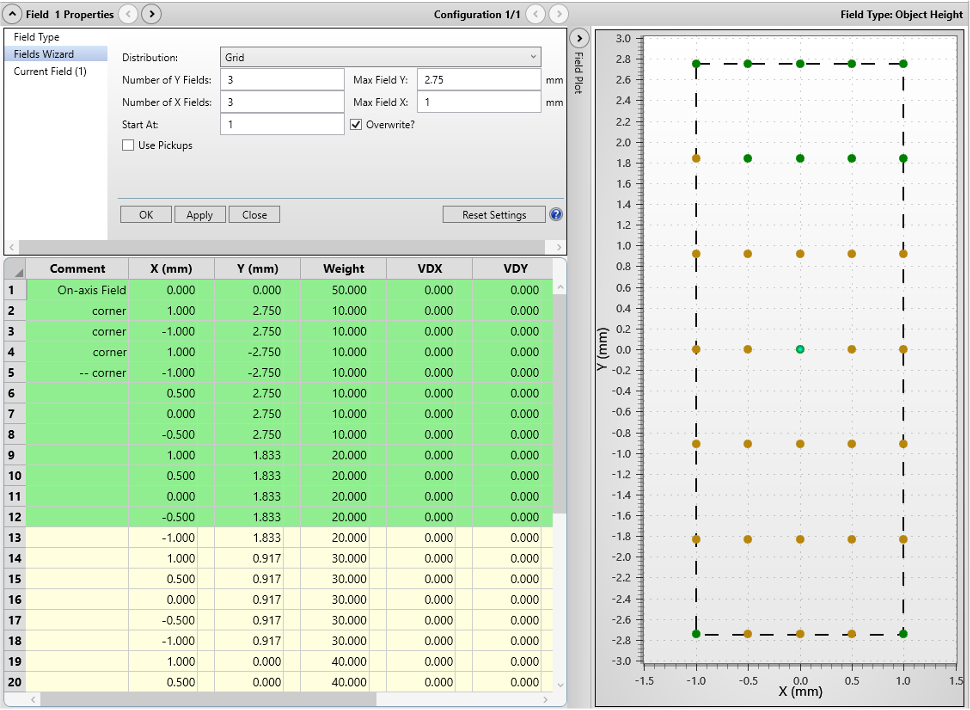

   **Figure 1:** Settings and plot of field points in Zemax on a 2D plane

Because the object is tilted, the field grid is not only a lateral sampling pattern. Each field point also corresponds to a different axial position along the oblique plane.

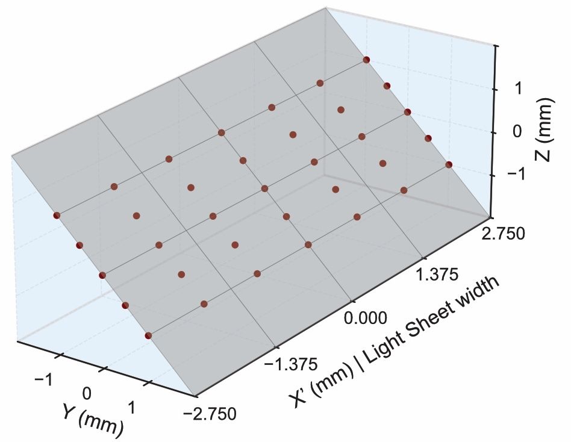

   **Figure 2:** A 3D visualization of the object surface and field points in the object as modeled in Zemax

**Optimization**

The detection relay was refined using the Zemax Optimization Wizard.

The primary optimization variables were:

- relay distances  
- camera (image plane) tilt  

The relay distances correspond to the physical separations between system components:

- specimen to O1  
- O1 to fold mirror (minimum spacing set by filter wheel)  
- fold mirror to O2 (minimum spacing set by kinematic mount)  
- O2 to camera  

Among these, the O2-to-camera distance and the camera tilt angle were found to be the most sensitive parameters. These directly control image plane alignment and defocus sensitivity, making them the dominant contributors to final image quality.

Because the system images an oblique plane, the image surface was allowed to tilt so that it aligns with the projected image formed by the relay.

The following optimization settings were used:

- Image Quality: Spot  
- Reference: Centroid  
- Gaussian Quadrature: maximum arms and rings 

The optimization was performed against the 35 weighted field points described above. Relay distances and image-plane tilt were iteratively refined to reduce spot size and maintain focus across the oblique field. The resulting geometry established the optical layout used for the implemented baseplate configuration.

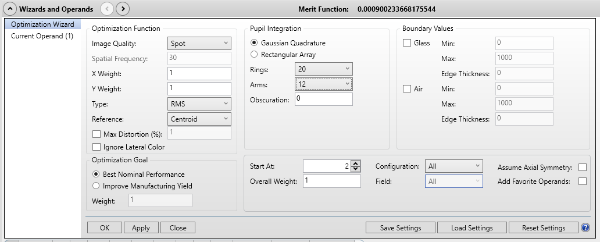

   Optimization Wizard settings used to optimize spot size across the detection-path field.

Detection Path: Zemax Analysis
______________________________

The analysis compares the implemented mechanically constrained relay against the nominal pupil-conjugated reference relay. The goal is to quantify what changes when the filter wheel and 2" fold mirror force the O1-O2 spacing to increase from 35.3 mm to the minimum buildable spacing of approximately 144.3 mm.

Three Zemax analyses were used, each addressing a different consequence of the increased spacing:

- Single Ray Trace analysis was used to evaluate camera-side telecentricity.
- Grid Distortion analysis was used to evaluate geometric fidelity.
- Huygens MTF analysis was used to estimate field-dependent resolution from the MTF20 criterion.

**Camera-side telecentricity**

Camera-side telecentricity was evaluated from chief-ray angles at the image surface using Zemax Single Ray Trace analysis over a 3 × 3 field grid. This analysis asks how close the chief rays remain to the desired camera-side propagation direction across the field.

In the nominal pupil-conjugated configuration, the maximum field-dependent chief-ray angle was 0.041°. In the implemented mechanically constrained configuration, the maximum field-dependent chief-ray angle increased to 3.20°. This increase is expected because the added O1-O2 spacing moves the relay away from the ideal bitelecentric condition. It does not prevent imaging, but it means that the chief rays reach the tilted camera surface with a larger field-dependent angular spread.

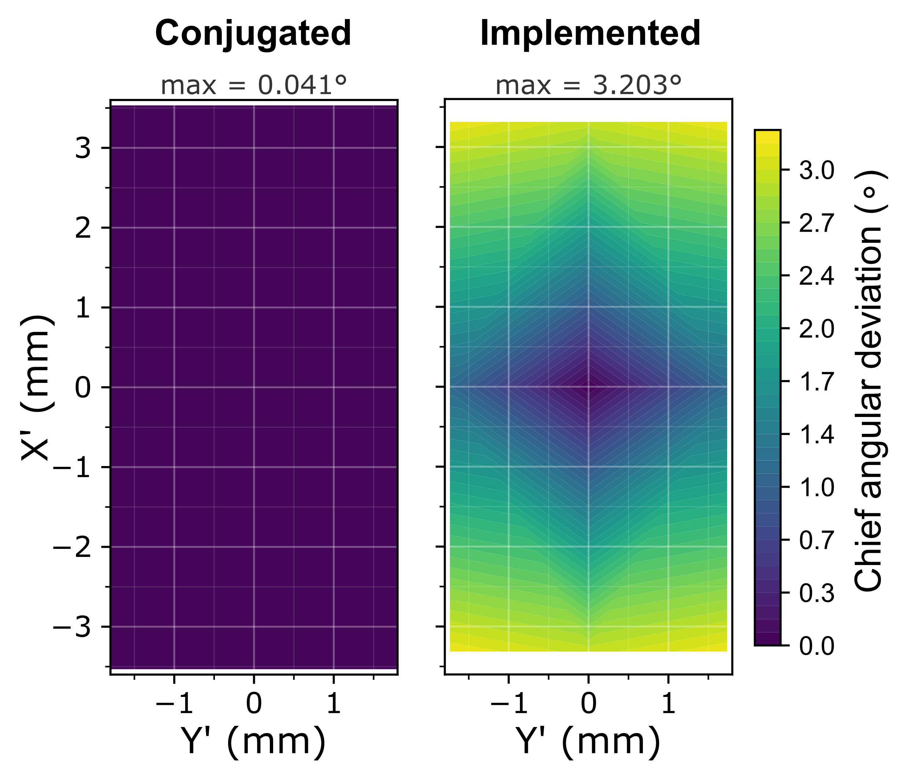

   **Figure 3:** Chief-ray angular deviation at the image plane for the nominal pupil-conjugated and implemented mechanically constrained detection configurations.

**Geometric distortion**

Geometric distortion was quantified using Zemax Grid Distortion analysis over the same 3 × 3 field grid used for the chief-ray calculation. This analysis evaluates whether the oblique object plane remains geometrically well mapped onto the tilted camera plane after the relay is folded and mechanically constrained.

The implemented relay showed a maximum signed image-plane distortion of 1.81%. This indicates modest field-dependent geometric distortion while preserving the overall mapping of the oblique plane onto the camera.

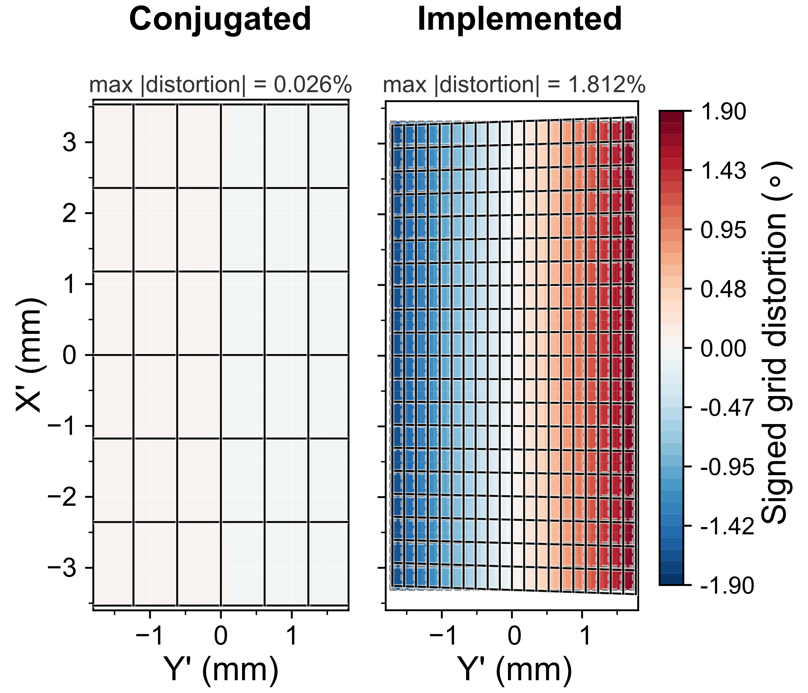

   **Figure 4:** Signed image-plane grid distortion for the nominal pupil-conjugated and implemented mechanically constrained detection configurations.

**MTF-derived resolution**

Field-dependent imaging performance was evaluated using Zemax Huygens MTF analysis at the same 35 weighted field points used during optimization. MTF was computed in both tangential and sagittal directions. These directions are defined locally at each field point and represent orthogonal orientations of spatial variation; because they are local coordinates, they do not map directly onto fixed global x and y axes across the full field.

The full MTF curves are useful because they show how contrast changes over spatial frequency before the MTF20 threshold is reduced to a single resolution value. In the field plot, each field point is assigned a color, and the corresponding curves use the same colors so that field position can be related directly to tangential and sagittal MTF behavior.

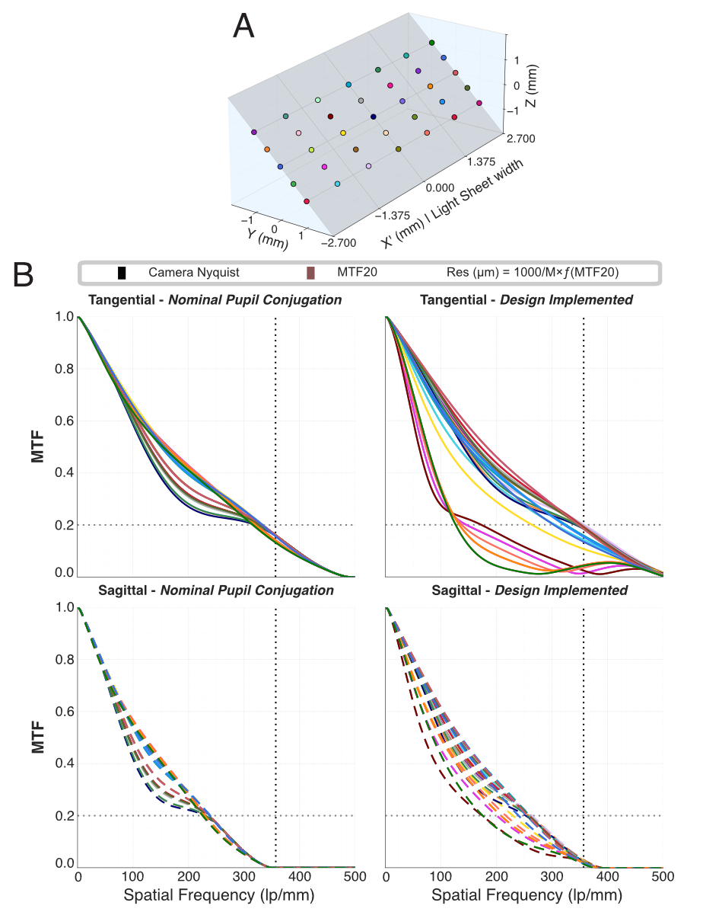

   **Figure 5:** Simulated modulation transfer function of the detection path. A. Oblique image plane with the 35 field points used for optimization and MTF analysis. B. Tangential and sagittal Huygens MTF curves for the nominal pupil-conjugated and implemented mechanically constrained configurations. The field-point colors in A correspond to the curve colors in B.

Resolution was quantified using the MTF20 criterion, defined as the spatial frequency at which the MTF drops to 20% contrast. The spatial frequency reported by Zemax is in image space, so object-space resolution was calculated as:

.. math::

   \mathrm{Resolution} = \frac{1000}{f_{\mathrm{image}} \cdot M}

where :math:`f_{\mathrm{image}}` is the spatial frequency at MTF20 in lp/mm, :math:`M = 1.307` is the system magnification, and the factor of 1000 converts millimeters to micrometers.

For the implemented relay, the optimized center-field simulated resolutions were:

- Tangential: approximately 2.23 µm
- Sagittal: approximately 3.02 µm

The added spacing between O1 and O2 primarily reduced simulated tangential resolution toward the field periphery. Sagittal resolution and the central field were comparatively preserved. This predicted peripheral sensitivity is a consequence of the mechanically necessary relay spacing rather than a failure of the direct-view concept.

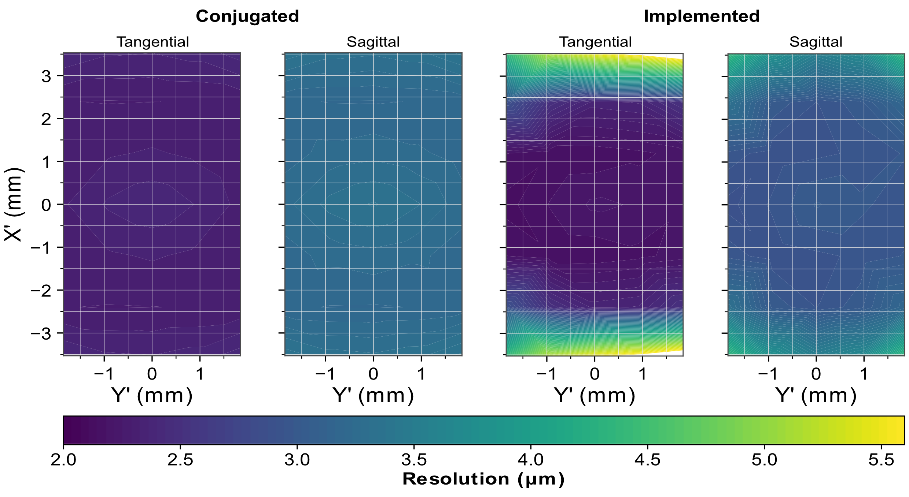

   **Figure 6:** Resolution maps derived from the MTF20 criterion in tangential and sagittal directions for the nominal pupil-conjugated and implemented mechanically constrained detection configurations.

These simulations identify a potential field-dependent sensitivity introduced by the non-bitelecentric spacing required for the filter wheel and fold-mirror assembly. The result should be interpreted as an optical prediction for the 561 nm detection model; experimental bead-based resolution measurements are described separately in the characterization section. Performance at the spectral extremes of the installed wavelength range, or at longer near-infrared wavelengths, has not yet been systematically characterized.

------------------------------

Illumination Path: Design
_________________________

The illumination path was designed to generate an oblique light sheet that covers the direct-view detection field while remaining mechanically compatible with a compact, baseplate-mounted microscope. The design problem is therefore not simply to make the thinnest possible sheet. The illumination relay must balance sheet thickness, sheet length, galvo pivot placement, stage clearance, launch angle, beam folding, and reproducible assembly.

From the detection design, the long-axis object-space coverage is approximately 5.4-5.5 mm. To ensure the illumination does not truncate the usable camera field, the design requirement is a light sheet longer than 5.5 mm along :math:`X'`. Any additional simulated extent beyond this value is useful design margin, not a separate hard requirement.

The excitation beam is first collimated from the fiber output and directed onto a Powell lens (L1; LOCP-8.9R10-2.0, Laserline Optics Canada) with a 10° fan angle. The Powell lens converts the input beam into an extended line profile, providing a more uniform illumination distribution across the long axis of the light sheet than a simple cylindrical focus.

Following the Powell lens, a 60 mm achromatic doublet (L2; AC254-060-A, Thorlabs) conditions the beam before it reaches the resonant galvanometer. The resonant galvanometer (RG; CRS 4 kHz, Novanta) provides rapid angular pivoting of the light sheet, which is included in the design to reduce shadowing and striping artifacts caused by absorption or scattering in the specimen.

After the galvo, the beam is relayed through a 300 mm / 250 mm achromatic telescope (L3; AC254-300-A and L4; AC254-250-A, Thorlabs). The telescope images the galvo pivot point onto the back focal plane of the downstream illumination optics so that scanning is introduced at the intended pupil conjugate. A variable mechanical slit (VA100CP, Thorlabs) is positioned within the relay to control the effective illumination numerical aperture and therefore tune the simulated sheet thickness.

Longer focal length relay optics were selected because they provide sufficient propagation distance to shape the beam into a thin, extended sheet at the sample while keeping the optics in practical orientations on a common baseplate. The tradeoff is a longer optical path, so planar fold mirrors are used to keep the footprint compact. After the relay, the beam is folded vertically by M2 and then reflected from a D-shaped mirror (M3; PFD10-03-P01, Thorlabs). M3 is inclined at 35° relative to the surface normal, launching the beam toward the specimen at approximately 20° relative to the stage.

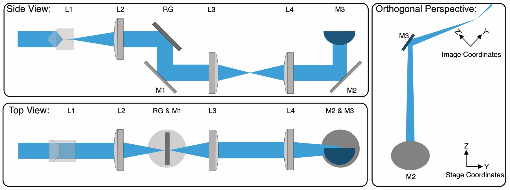

   **Figure 7:** Schematic of the illumination path for light-sheet generation, shown in side view, top view, and orthogonal perspective.

The labeled elements shown in Figure 7 are summarized below.

.. list-table::
       :header-rows: 1

       * - Element
         - Component
         - Design role
       * - L1
         - LOCP-8.9R10-2.0 Powell lens
         - Generates the extended line profile for light-sheet formation
       * - L2
         - AC254-060-A achromatic doublet, f = 60 mm
         - Conditions the beam before scanning
       * - RG
         - CRS 4 kHz resonant galvanometer
         - Rapidly pivots the light sheet for shadow mitigation
       * - M1
         - PF10-03-P01 Ø1" planar mirror
         - Restores the folded beam path after the galvo
       * - L3
         - AC254-300-A achromatic doublet, f = 300 mm
         - Forms the first relay lens of the illumination telescope
       * - L4
         - AC254-250-A achromatic doublet, f = 250 mm
         - Forms the second relay lens of the illumination telescope
       * - M2
         - PF10-03-P01 Ø1" planar mirror
         - Redirects the beam upward toward the final launch mirror
       * - M3
         - PFD10-03-P01 D-shaped mirror
         - Launches the beam obliquely toward the specimen
         
------------------------------

Illumination Path: Zemax Setup
______________________________

The illumination system was modeled in Zemax at 561 nm using a collimated input beam with a 2 mm pupil diameter. This is the design aperture used for the illumination simulation and should not be confused with the detection NA.

The achromatic doublets were modeled using manufacturer-supplied Zemax lens files from the Thorlabs library. The Powell lens was included using a reverse-engineered model of its line-generating optical behavior. The resonant galvanometer was modeled as a static planar mirror, so the Zemax model captures the relay geometry and pivot placement but does not simulate time-dependent galvo scanning.

The illumination path was constructed sequentially. As each element was introduced, the relevant inter-element spacing was varied to satisfy a specific collimation or focusing condition in the appropriate beam dimension. Once a spacing was optimized, it was fixed before the next element was added. This stepwise approach made the optical intent of each relay section explicit and prevented later optimization steps from undoing earlier beam-shaping conditions.

**Sequential Design Procedure**

- L1 (Powell lens) and L2 were placed first. The L1-L2 distance was adjusted so that the beam became collimated in the y-dimension after L2.

- A planar mirror representing the resonant galvo was placed after L2. The L2-galvo distance was adjusted so that the beam focused in the x-dimension at the galvo location.

- A second planar mirror was introduced to restore the beam propagation direction. The distance between the galvo mirror and this fold mirror was fixed at 25.564 mm to match the mechanical design constraint.

- L3 was placed after the fold mirror, and the fold-mirror-to-L3 distance was adjusted so that the beam became collimated in the x-dimension after L3.

- L4 was placed after L3, and the L3-L4 distance was adjusted to achieve collimation in the y-dimension after L4.

- A vertical fold mirror was introduced to direct the beam upward toward the sample region.

- The final D-shaped launch mirror was placed after the vertical fold mirror and inclined at 35°. The distance between these mirrors was fixed at 91.5 mm to match the baseplate and side-plate geometry.

- Finally, the distance from the launch mirror to the image plane was adjusted so that the beam reached the desired x-dimension focus at the simulated sample plane.

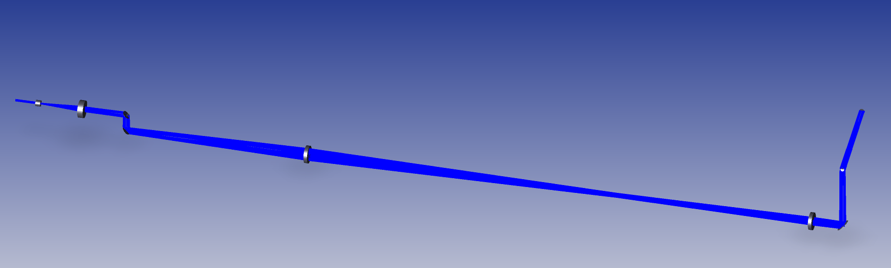

   **Figure 8:** 3D layout of the complete illumination train as modeled in Zemax.

------------------------------

Illumination Path: Zemax Analysis
_________________________________

The illumination analysis evaluates the simulated design, not the experimentally assembled light sheet. Experimental light-sheet measurements are described separately in the characterization section.

Simulated illumination performance was evaluated using Huygens PSF Cross-Section and 2D Huygens PSF analyses. The Huygens PSF Cross-Section was used to estimate the thickness of the designed sheet at the beam waist. At 561 nm, the simulated full width at half maximum (FWHM) was:

- Predicted sheet thickness: 13.6 µm FWHM

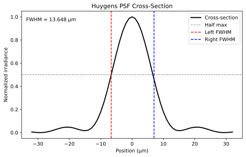

   **Figure 9:** Simulated Huygens PSF cross-section of the designed light sheet at 561 nm. The predicted FWHM is approximately 13.6 µm.

The 2D Huygens PSF was used to assess the simulated sheet extent and continuity across the long axis. This analysis is useful for checking whether the designed sheet covers the detection field, but it is not the measurement used to quantify sheet thickness.

The simulated sheet length exceeded the >5.5 mm requirement along :math:`X'`. This design margin helps ensure that the illumination covers the full camera-limited field in the optical model.

Together, the simulated cross-section and 2D PSF indicate that the illumination design satisfies the two design targets: a micron-scale sheet thickness and a sheet length greater than the direct-view detection field. The static Zemax outputs do not include time-averaged effects from resonant galvo scanning or experimentally measured beam nonuniformity.

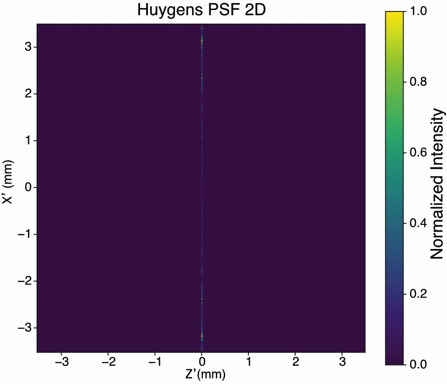

   **Figure 10:** Simulated 2D Huygens PSF showing the extended illumination sheet used to assess design coverage along :math:`X'`.

The simulated detection and illumination geometries define the optical constraints that must be preserved in the physical instrument. The next section describes how those constraints were translated into mechanically registered baseplate modules, including the fixed spacings, folded beam paths, custom adapters, and alignment degrees of freedom required for assembly.
