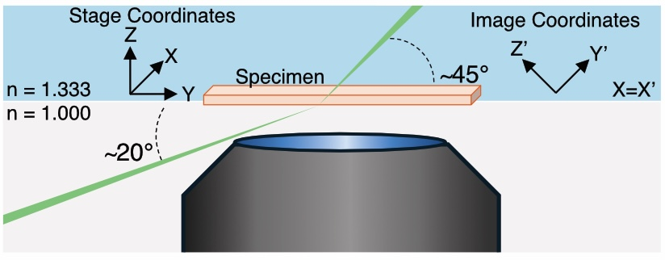

.. _dvopmoverview-home:

##############################
Altair-dvOPM Overview
##############################

Direct-View OPM
_______________

Direct-view oblique plane microscopy (dvOPM) is an oblique-plane light-sheet imaging architecture designed for mesoscopic fluorescence imaging. In this approach, fluorescence from an obliquely illuminated plane is detected through a remote-image-space geometry and projected directly onto a camera sensor.

Direct-view OPM was introduced by Lamb *et al.* as a way to eliminate the tertiary imaging system used in conventional oblique plane microscopy. Instead of re-imaging the tilted intermediate image with an additional objective, the camera is placed directly in the remote image space. This avoids a major scaling bottleneck for large-field, low-NA OPM while preserving the optical sectioning and volumetric throughput advantages of light-sheet microscopy.

Altair-dvOPM builds on that direct-view architecture by using fast photographic lenses with externally accessible pupils. This simplifies the remaining pupil-coupling requirement, removes the need for an additional pupil-mapping relay, and translates dvOPM into an open-access, baseplate-mounted instrument with detailed CAD files, lens models, bills of materials, and assembly instructions.

------------------------------

System Architecture
___________________

The Altair-dvOPM system consists of separate detection and illumination modules arranged around a shared open-top sample region. The illumination path generates an oblique light sheet that intersects the specimen, while the detection path collects fluorescence from the illuminated plane and forms the oblique image directly on the camera sensor.

The detection subsystem uses a Mitakon Speedmaster 65 mm f/1.4 photographic lens as the primary lens and a Nikon AF-S NIKKOR 85 mm f/1.4G photographic lens as the secondary lens. A 32 mm, 6-position emission filter wheel (FW-0002-6, Applied Scientific Instrumentation) and fold mirror are positioned between the lenses, and the remote image is recorded by a compact Ximea MU196MR-ON camera with 1.4 µm pixels. The detection path is mounted on a custom baseplate and vertically positioned with a motorized linear stage for focusing relative to the specimen.

The illumination subsystem is implemented as an independent optical train. It begins with a fiber-collimated laser beam and a Powell lens, followed by achromatic relay optics, a mechanical slit for controlling illumination numerical aperture, and a 4 kHz resonant galvanometer for rapid angular pivoting of the light sheet. After light-sheet formation, the beam is folded vertically and launched externally through the coverslip at an oblique angle.

The system operates in a stage-scanning geometry: the detection and illumination modules remain fixed, and the sample is translated through the stationary oblique imaging plane to acquire volumes. This separates optical alignment from volumetric acquisition and makes large tiled acquisitions possible without repeatedly moving the optical subsystems.

------------------------------

Optical Geometry
________________

    **Figure 1:** Schematic geometry of the Altair-dvOPM system.

The illumination light sheet is launched externally through the coverslip at an angle of approximately 20° and refracts to approximately 45° upon entering the aqueous specimen. Fluorescence from the obliquely illuminated plane is collected in the epi-direction by the photographic-lens-based detection path.

Unprimed axes denote the stage coordinate system: :math:`Y` is the sample-scanning direction, :math:`Z` is the specimen-depth direction, and :math:`X` is parallel to the long axis of the light sheet. Primed axes denote the oblique image coordinate system recorded by the camera: :math:`Y'` is the light-sheet propagation direction, :math:`X'` is the long axis of the light sheet, and :math:`Z'` defines the light-sheet thickness. The stage :math:`X` axis corresponds to the image :math:`X'` axis.

Each camera frame captures an :math:`X'Y'` oblique plane. Volumetric imaging is performed by translating the specimen along stage :math:`Y`; following acquisition, image stacks are computationally sheared and rotated into the stage coordinate frame for visualization.

------------------------------

Performance Snapshot
____________________

The assembled Altair-dvOPM system provides the following experimentally characterized performance:

- Magnification: approximately 1.308×
- Instantaneous field of view: approximately 5.4 × 2.8 mm in :math:`X'Y'`
- Detection numerical aperture: 0.18 used, with 0.25 maximum available from the photographic-lens pair
- Measured bead FWHM resolution: 2.55 ± 0.19 µm, 3.36 ± 0.19 µm, and 17.75 ± 1.40 µm along :math:`X'`, :math:`Y'`, and :math:`Z'`
- Measured light-sheet thickness: 16.02 µm FWHM along :math:`Z'`
- Measured light-sheet lateral extent: approximately 6.0 mm along :math:`X'`

The following sections describe the optical design, baseplate implementation, assembly procedure, alignment workflow, and characterization measurements in greater detail.
The detailed optical design and implementation of the detection and illumination subsystems are described in the following section.
